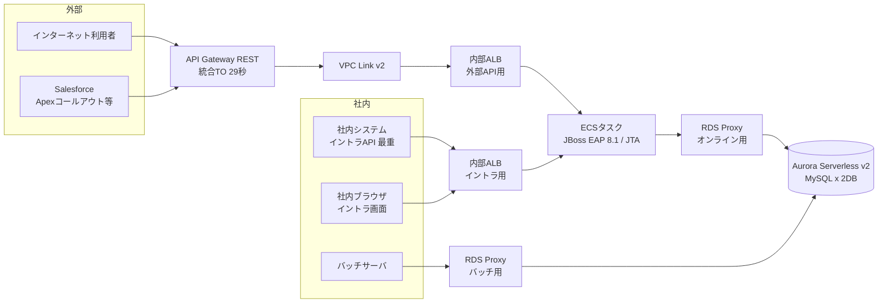

# Aurora Serverless v2 共有構成のタイムアウト設計ガイド

作成日：2026-10-17　／　対象：API Gateway（REST）・VPC Link v2・ALB・ECS（JBoss EAP 8.1／JTA）・RDS Proxy・Aurora Serverless v2 MySQL（2DB）

<a id="s00"></a>

## 00. はじめに

インターネットAPI／Salesforce API／イントラAPI／イントラ画面／バッチの5つの経路が、同じ RDS Proxy と Aurora Serverless v2 MySQL（2DB）を共有するときに、各タイムアウト値をどう決めればよいかを、動作原理・歴史・推奨値（複数パターン）・設定例までまとめた資料です。

### この資料の前提

| 項目 | 内容 |
|---|---|
| 作成日 | 2026-10-17（2026年10月時点の公開ドキュメントをもとに作成） |
| 対象構成 | インターネットAPI：API Gateway（REST）→ VPC Link v2 → ALB → ECSタスク（JBoss EAP 8.1／JTA）→ RDS Proxy → Aurora Serverless v2 MySQL（2DB）<br>Salesforce API：同上（API Gateway 経由）<br>イントラAPI：ALB → ECSタスク → RDS Proxy → Aurora（API Gateway なし）<br>イントラ画面：ALB → ECSタスク → RDS Proxy → Aurora（API Gateway なし）<br>バッチ：バッチサーバ → RDS Proxy → Aurora（直接） |
| 負荷の前提 | 最も負荷が高く処理時間が長いのは「イントラAPI」。バッチはオンライン時間帯にも動く可能性がある。 |
| 2DBの前提 | 2つのDBはそれぞれ別の Aurora クラスタ（クラスタごとに RDS Proxy）と想定。同じクラスタ内の2スキーマの場合は「Proxyは1つ」と読み替える。2DBを1つのトランザクションで更新する場合は JTA＋XA（2相コミット）。 |
| 数値の扱い | 既定値・上限値は公式ドキュメントで確認したもの（16_参考資料）。推奨値は設計上の目安であり、実測（P99応答時間）と試験で必ず調整すること。【要検証】と書いた項目は、公式記載がない・環境依存のため PoC で確認が必要なもの。 |

### 結論（まずここだけ読めばよい3つの原則）

| 原則 | 内容 | 具体例 |
|---|---|---|
| ① 外側ほど長く、内側ほど短く | リクエストの通り道では、内側（DBに近い側）のタイマーが先に鳴るようにする。内側が後片付け（ロールバック・接続返却）をしてから、理由つきのエラーを外側に返せる。 | 呼出元 40秒 ＞ API Gateway 29秒 ＞ アプリ期限（JTA）25秒 ＞ SQL上限 20秒 ＞ ロック待ち 10秒 |
| ② つなぎっぱなしの線は、使う側が先に切る | keep-alive やコネクションプールの「アイドル（無通信）」タイマーは、接続を使う側（クライアント側）を短く、待つ側（サーバ側）を長くする。逆だと切れた線にリクエストを送ってしまう。 | ALB idle 60秒 ＜ Undertow no-request-timeout 75秒／JBossプール idle 10分 ＜ RDS Proxy IdleClientTimeout 30分 ＜ Aurora wait_timeout 8時間／接続寿命 ＜ 24時間 |
| ③ 共有部品の値は1つしか持てない | ALB（LB単位）、RDS Proxy（Proxy単位）、Aurora（クラスタ単位）は経路ごとに値を変えられない。部品を分けるか、リクエスト単位の仕組みで調整する。 | ALBを外部API用とイントラ用に分ける／RDS Proxyをオンライン用とバッチ用に分ける／@TransactionTimeout・set-tx-query-timeout・SQLヒントで経路別に |

> **【推奨】** 本件の推奨は「P2 経路分離型」（06_推奨値_P2）。外部API用ALBとイントラ用ALBを分け、ECSサービスを外部API／イントラAPI／画面に分け、RDS Proxy をオンライン用とバッチ用に分ける。2分を超える処理は「P4 非同期型」へ逃がす。

### シート一覧（クリックで移動）

| 章 | 内容 | こんなときに読む |
|---|---|---|
| [01_小学生向け](#s01) | レストランのたとえ話で全体像と3つの原則をつかむ | 初めて読むとき、関係者に説明するとき |
| [02_構成と経路](#s02) | 5経路が通る部品、共有部品の「1つしか持てない設定」、2DB（XA）の注意 | 構成の前提を確認するとき |
| [03_歴史と背景](#s03) | TCPから2025年のVPC Link v2まで。各タイムアウトが生まれた理由 | なぜその設定が必要かを知りたいとき |
| [04_動作原理](#s04) | 時計の動き方、3原則の深掘り、リトルの法則、RDS Proxy・JTAの内部動作、返るエラー | 値の大小関係の根拠を知りたいとき |
| [05_パラメータ辞典](#s05) | 全パラメータの既定値・範囲・適用単位・超えたときの動作 | 個別の設定値を調べるとき |
| [06_推奨値_P2](#s06) | 本件のおすすめ設定（経路分離型）の推奨値マトリクス | まず設定値を決めたいとき |
| [07_推奨値_全パターン](#s07) | P0（既定値）〜P5（バッチ直結）の推奨値マトリクス | 別の構成案と比べたいとき |
| [08_パターン比較](#s08) | 6パターンの長所・短所と、選び方の質問表 | どのパターンにするか決めるとき |
| [09_動作イメージ](#s09) | タイムアウトの梯子図と、障害時・デプロイ時の時系列 | 動きを目で確かめたいとき |
| [10_障害シナリオ](#s10) | 14の障害で、既定値と推奨値の挙動を比較 | 試験項目・障害対応を考えるとき |
| [11_計算シート](#s11) | アプリ期限を入れると外側・内側の値と整合性チェックを自動計算 | 自分の要件で値を出し直すとき |
| [12_設定例](#s12) | JBoss CLI／XML、Java、Apex、AWS CLI、ECS、バッチ、試験用SQL | 実際に設定するとき |
| [13_監視とチューニング](#s13) | 見るべきメトリクスとアラーム、見直しの手順 | 運用設計のとき |
| [14_チェックリスト](#s14) | 設計・試験・運用の確認項目（25項目） | レビュー・試験のとき |
| [15_用語集](#s15) | 専門用語の意味と小学生向けのひとこと | 言葉が分からないとき |
| [16_参考資料](#s16) | 確認に使った公式ドキュメントのURL | 原典を確かめるとき |

### 凡例

| 表記 | 意味 |
|---|---|
| 濃いグレーの見出し | 表の見出し、または章の見出し |
| 薄いグレーの網掛け＋太枠（11_計算シート） | 入力セル。ここを書き換えると推奨値とチェック結果が再計算される |
| — | その経路では該当しない（通らない部品など） |
| 【要検証】 | 公式ドキュメントに記載がない、または環境・バージョン依存。PoC（試験）で確認すること |
| P0〜P5 | 推奨値のパターン番号（07_推奨値_全パターン、08_パターン比較） |

[↑ 目次へ戻る](#s00)

---

<a id="s01"></a>

## 01. まずはイメージ：タイムアウトってなに？

タイムアウトは「待つのをやめる時間」のことです。ずっと待っていると、ほかの人まで待たされてしまうので、「〇秒たったら、あきらめて『ダメでした』と伝える」という決まりをつくります。

### たとえ話：システムをレストランで考えよう

| システムの部品 | レストランでいうと | どんな仕事？ |
|---|---|---|
| 呼び出し元（ブラウザ、Salesforce、社内システム） | お客さん | 注文して、料理が出てくるのを待つ。何分まで待つかを決めている |
| API Gateway | 外のお客さん専用の受付係 | 外から来た注文を受け付ける。29秒たっても料理が来なければ「すみません、時間切れです」と言う決まりがある |
| VPC Link v2 | 受付から店の中への専用通路 | 外の受付係が、店の中の案内係に安全に注文を渡すための通路 |
| ALB | ホールの案内係 | 空いている料理人に注文を回す。料理人から決められた時間なにも返事がないと「時間切れ」と言う |
| ECSタスク（JBoss EAP） | 料理人 | 実際に料理（業務の処理）をつくる |
| JTA（トランザクション） | 「全部そろったら出す」ルールと、制限時間 | スープとご飯の両方ができないとお客さんに出さない。制限時間をすぎたら作りかけを捨ててやり直す |
| コネクションプール（JBoss） | 料理人が持っている倉庫の通行証 | 倉庫に入るための通行証を何枚か持っていて、使い回す。全部使っているときは返ってくるまで待つ |
| RDS Proxy | 倉庫の入口の貸出係 | たくさんの料理人に、少ない倉庫の扉を順番に貸し出す。扉が全部使われていたら、決めた時間だけ待ってもらう |
| Aurora Serverless v2（2DB） | 自動で広さが変わる倉庫（2つ） | 食材（データ）をしまったり出したりする。混んでくると自動で棚と店員が増える |
| バッチ | 夜の大掃除・棚卸し係 | たくさんの作業をまとめて行う。時間が長くかかる |

### いちばん大事な決まり：外側ほど長く待つ、内側ほど早くあきらめる

お母さんがお兄さんに「10分で牛乳を買ってきてね」と頼み、お兄さんは弟に「30分かかってもいいよ」と頼んだとします。10分たつと、お母さんは「遅いな」と別の人に頼みなおします。そのあと弟が牛乳を買って帰ってくると、牛乳が2本になってしまいます。システムでいうと「二重登録」です。弟（内側）が先に「売り切れだったよ」と帰ってくれば、こうはなりません。

|  | 外側が先にあきらめると | 内側が先にあきらめると |
|---|---|---|
| 結果 | 中では仕事が続いたまま（ムダな仕事、二重の仕事） | 「なぜダメだったか」がちゃんと外側に伝わる |
| 後片付け | だれも片付けない（ロックや接続が残る） | 内側がきれいに片付けてから報告する |
| やりなおし | やりなおしの注文と、まだ続いている仕事がぶつかる | 安心してやりなおせる |

### 2つめの決まり：つなぎっぱなしの電話は、かけた側が先に切る

案内係（ALB）と料理人（JBoss）は、毎回つなぎなおすと時間がかかるので、糸電話をつなぎっぱなしにしています（keep-alive）。料理人のほうがだまって先に糸を切ってしまうと、案内係は気づかずに次の注文を切れた糸に話しかけてしまい、注文が届きません（502エラー）。だから「使う側（案内係）が先に切る」ように、料理人の待ち時間を案内係より長くしておきます。

### 3つめの決まり：みんなで使う物は、決まりを1つしか持てない

倉庫の貸出係（RDS Proxy）が1人だと、「昼のお客さん用の料理人は10秒であきらめる」「夜の大掃除係は2分待つ」と、人によって決まりを変えられません。そこで、貸出係を2人にする（オンライン用とバッチ用で RDS Proxy を分ける）と、それぞれに合った決まりにできます。

### 待ちには5つの種類がある

| 待ちの種類 | たとえ | システムの例 |
|---|---|---|
| つながるまでの待ち（接続タイムアウト） | 電話がつながるまで | Connector/J の connectTimeout |
| 順番待ち（取得・借用タイムアウト） | 傘立ての傘が返ってくるまで | JBoss の blocking-timeout-wait-millis、RDS Proxy の ConnectionBorrowTimeout |
| 仕事が終わるまでの待ち（処理・応答タイムアウト） | 料理ができるまで | API Gateway の統合タイムアウト、JTA、query timeout、ロック待ち |
| だまっている時間の上限（アイドルタイムアウト） | 糸電話で無言が続いたら切る | ALB idle、Undertow no-request-timeout、RDS Proxy IdleClientTimeout、wait_timeout |
| 使える期間の上限（寿命） | 通行証の有効期限 | RDS Proxy のクライアント接続は最長24時間（変えられない） |

### 5つの道（経路）をひとことで

| 経路 | たとえ | 待てる長さのめやす |
|---|---|---|
| インターネットAPI | 外のお客さん。受付係（API Gateway）が29秒で必ず打ち切る | 25秒以内に答えを返す |
| Salesforce API | 取引先のお店からの電話注文。相手の電話は何もしないと10秒で切れる設定 | 25秒以内に返す。相手の待ち時間は40秒に設定してもらう |
| イントラAPI（最重） | 社内からの大口注文。外の受付係を通らないので長く待てる | 2分（120秒）まで。それより長いものは「あとで届けます（非同期）」にする |
| イントラ画面 | 店の中で人が立って待っている | 30秒まで（人は10秒をこえるとイライラして、もう一度ボタンを押しがち） |
| バッチ | 夜の大掃除 | 全体は数分〜数時間。ただし小分け（チャンク）にして、1回の片付けは5分以内 |

> **【ポイント】** タイムアウトは「早く終わらせる魔法」ではありません。「困ったときに、どこまで被害を広げないか」を決める安全装置です。遅い原因（重いSQL、足りない容量）は別に直す必要があります。

[↑ 目次へ戻る](#s00)

---

<a id="s02"></a>

## 02. 全体構成と5つの経路

どの経路がどの部品を通るかを整理します。通る部品が多いほど「外側のタイマー」が増え、順番の設計が大切になります。（図の ALB と RDS Proxy の分け方は推奨パターン P2 の場合。P1 では1つずつを共有）



### 経路 × 通過する部品

| 経路 | 呼び出し元 | API Gateway | VPC Link v2 | ALB | ECSタスク（JBoss EAP 8.1） | RDS Proxy | Aurora Serverless v2 |
|---|---|---|---|---|---|---|---|
| インターネットAPI | 不特定のクライアント（スマホアプリ、取引先システム等） | ●（REST・Regional）<br>統合TO 既定29秒 | ● | ●（内部ALB） | ●（JTA） | ● | ●（DB-A／DB-B） |
| Salesforce API | Salesforce（Apex／Flow／External Services）<br>コールアウト既定10秒 | ● | ● | ● | ● | ● | ● |
| イントラAPI（最重） | 社内システム（Direct Connect／VPN 経由） | — | — | ● | ●（長時間処理） | ● | ● |
| イントラ画面 | 社内ユーザーのブラウザ | — | — | ● | ●（画面描画） | ● | ● |
| バッチ | バッチサーバ | — | — | — | — | ● | ● |

### 経路ごとの性格と、タイムアウト設計の主役

| 経路 | 主な制約 | 負荷・処理時間の性格 | タイムアウト設計の主役 | 特に注意すること |
|---|---|---|---|---|
| インターネットAPI | API Gateway の統合タイムアウト（既定上限29秒。Regional／Private の REST API は申請で引上げ可。Edge最適化は不可） | 短時間・高頻度（高TPS） | API Gateway 29秒に収まるアプリ期限（25秒） | API Gateway が504を返しても裏の処理は止まらない → アプリ期限を必ず短く |
| Salesforce API | Salesforce のコールアウト：既定10秒、最大120秒、1つの Apex トランザクション内の累計も120秒 | 中程度、同期連携 | Salesforce の setTimeout ＞ API Gateway ＞ アプリ期限 の順序 | 既定10秒のままだと Salesforce が先に諦めて再送→二重登録。冪等キー必須 |
| イントラAPI（最重） | ALB の idle_timeout（LB単位、1〜4000秒）。社内FW・プロキシのタイマー | 最も重い（長時間・大量データ）。少ない件数でも接続を長く占有 | ALB idle とアプリ期限（120秒）、他経路からの隔離 | 同じスレッド・プール・Proxy を共有すると他経路を巻き込む（連鎖障害） |
| イントラ画面 | 人の我慢（約10秒で離脱・再クリック）、ブラウザ | 対話的・短時間 | 画面の応答期限（30秒） | タイムアウト後の再クリックによる二重送信。長い処理は非同期＋進捗表示 |
| バッチ | RDS Proxy の IdleClientTimeout・ConnectionBorrowTimeout・24時間寿命、オンラインとのロック競合 | 長時間・大量・少数の長い接続 | チャンク（コミット単位）ごとの期限、バッチ専用 Proxy | 長いトランザクションはロックとUndo履歴を溜め、オンラインを遅くする |

### 共有されている部品と「値を1つしか持てない」設定

| 部品 | 共有する経路 | 1つしか持てない設定（適用単位） | 分ける方法 |
|---|---|---|---|
| 内部ALB | P1ではオンライン全経路 | idle_timeout.timeout_seconds（LB単位）、client_keep_alive.seconds（LB単位） | 外部API用（VPC Link v2 の先）とイントラ用で ALB を分ける。登録解除遅延などはターゲットグループ単位なので経路別にできる |
| ECSサービス／JBoss EAP | P1ではオンライン全経路 | Undertow no-request-timeout（HTTPリスナー単位）、transactions default-timeout（サーバ単位）、データソース設定（DS単位） | ECSサービスを分割する。分割できない場合は @TransactionTimeout（メソッド単位）や UserTransaction.setTransactionTimeout() で経路別に |
| RDS Proxy | 全経路（バッチ含む） | IdleClientTimeout（Proxy単位）、ConnectionBorrowTimeout・MaxConnectionsPercent・InitQuery（ターゲットグループ単位＝実質Proxy単位） | 同じクラスタに複数の Proxy を作れる（オンライン用・バッチ用）。アカウント既定上限は20 Proxy |
| Aurora クラスタ | 全経路 | クラスタ／DBパラメータグループ（innodb_lock_wait_timeout、wait_timeout、max_execution_time などの全体既定） | セッション単位で変える。ただし追跡対象外の変数の SET は RDS Proxy のピン留め要因 → Proxy の InitQuery、SQLヒントで代替 |
| Aurora の容量（ACU） | 全経路 | 最小／最大 ACU（クラスタ単位）。max_connections は最大 ACU から決まる | 重い読み取りはリーダーへ（昇格階層2〜15のリーダーはライターと独立してスケール）。業務時間帯の前に最小ACUを上げる |

### 2DB（JTA＋XA／2相コミット）の前提と注意

- 2つのDBを1つのトランザクションで更新する場合は XA（2相コミット）になる。各DBに XA データソース（com.mysql.cj.jdbc.MysqlXADataSource）を使う。
- AWS は Aurora MySQL での XA トランザクションを推奨していない（PREPARED 状態のまま残ると復旧時間が長くなる）。使う場合は「PREPAREDのまま放置しない」「XAは小さく」。PREPAREDが残っているとインプレースアップグレードも中止される。
- RDS Proxy のドキュメントには XA の挙動（ピン留め・多重化）の明記がない。【要検証】XA START／END／PREPARE／COMMIT、XA RECOVER、フェイルオーバー時の動きを PoC で確認する。Connector/J には pinGlobalTxToPhysicalConnection=true を設定する。
- ECS（コンテナ）で XA を使う場合、Narayana のトランザクションログ（ObjectStore）がタスク停止で消えると、PREPARED の「迷子トランザクション」を回復できない。永続ストア（JDBCオブジェクトストア等）と、タスクごとに一意な node-identifier が必要。
- PREPARED のまま残った XA はロックを持ち続ける。これが他の経路のロック待ちタイムアウトの原因になる。
- 代替案：1トランザクション1DBに設計し直す（Saga・補償処理・Transactional Outbox）、または Narayana の LRCO（最後の1資源を非XAで扱う最適化）。

[↑ 目次へ戻る](#s00)

---

<a id="s03"></a>

## 03. タイムアウトの歴史と背景：なぜ必要になったのか

ネットワークの向こう側は見えません。相手が「壊れている」のか「遅いだけ」なのかを区別できないため、「一定時間で見切りをつける」仕組み＝タイムアウトが、通信が生まれたときから必要でした。その後、接続の使い回し（keep-alive・コネクションプール）、分散トランザクション、クラウドの共有部品が登場するたびに、新しいタイムアウトが増えてきました。

### 年表

| 年 | 出来事 | なぜ必要になったか（背景） | 今回の設計とのつながり |
|---|---|---|---|
| 1961 | リトルの法則 L＝λW（J.D.C. Little が証明） | 待ち行列の基本法則。同時に処理中の数 L は、到着率 λ × 滞在時間 W | 処理時間が伸びると同時接続数が比例して増える。タイムアウトは W の上限＝同時接続数の上限（04_動作原理） |
| 1968 / 1993 | 応答時間の3つの限界（0.1秒・1秒・10秒）。R.B. Miller の研究（1968）を J. Nielsen が整理（1993） | 人がどれくらい待てるかの目安 | 画面は10秒を超えると離脱・再クリックが増える → 30秒で必ず打ち切り、長いものは非同期＋進捗表示 |
| 1981 | TCP（RFC 793） | 再送タイムアウト。相手の故障と遅延を区別できないため、一定時間で諦める仕組みが必須に | 接続タイムアウト（connectTimeout）の原点 |
| 1989 | RFC 1122 で TCP keep-alive を規定（既定の間隔は2時間以上） | 黙ったまま壊れた接続（半開き接続）を見つけるため | バッチの長い待ちでの生死確認（tcpKeepAlive、socketTimeout） |
| 1991 | X/Open XA 仕様（2相コミット） | 複数のDBを「全部成功か、全部取消か」にする標準 | 2DB更新（JTA＋XA）。PREPARED のまま残るリスク |
| 1995 | MySQL 初公開。wait_timeout（既定8時間）で放置接続を掃除 | 1接続1スレッドのDBでは、放置接続がメモリを食う | wait_timeout ≧ RDS Proxy IdleClientTimeout |
| 1996〜1999 | HTTP/1.0（RFC 1945、1接続1リクエスト）→ HTTP/1.1（RFC 2068／2616）で持続的接続（keep-alive）が既定に | TCP接続を毎回作るコストを削減。代わりに「いつ切るか」のアイドルタイムアウトが必要に | ALB idle と Undertow no-request-timeout の大小関係（502対策） |
| 1997 / 1999 | JDBC 1.0（Statement.setQueryTimeout）／JDBC 2.0 拡張で DataSource・コネクションプール・XADataSource | DB接続の作成は重いので使い回す（プール）。プールが空だと「借りる待ち」が生まれる | blocking-timeout-wait-millis、query-timeout |
| 1999 | JTA 1.0（J2EE 1.2） | Javaで分散トランザクション。期限切れの取引を回収する仕組み（Reaper） | JTA default-timeout（JBoss EAP 既定300秒） |
| 2001前後 | InnoDB が MySQL に統合。innodb_lock_wait_timeout（既定50秒） | 行ロックの待ちが永遠に続かないようにする | オンラインは短く（10秒）、バッチは長く（120秒） |
| 2005〜2006 | JBoss が Arjuna のトランザクション技術を取得（のちの Narayana）。Red Hat が JBoss を買収（2006） | 企業向け Java EE の標準実装 | JBoss EAP のトランザクションマネージャ（Narayana）と Reaper |
| 2007 | 『Release It!』（M. Nygard）がタイムアウト・サーキットブレーカー・バルクヘッドを提唱 | 1つの遅い部品が全体を巻き込む「連鎖障害」の教訓 | 重いイントラAPIの隔離（バルクヘッド）、短いプール待ち |
| 2009 / 2014 | AWS ELB 登場（アイドルタイムアウト60秒固定）→ 2014年に変更可能に | クラウドのLBは大量の接続を抱えるため、黙った接続を掃除する | ALB idle の既定60秒の由来 |
| 2010 | MySQL 5.5 で lock_wait_timeout（メタデータロック、既定1年） | DDL と DML の衝突 | DDL は Proxy を通さず、セッションで短く設定して実行 |
| 2015 | API Gateway 一般提供（統合タイムアウト上限29秒）。MySQL 5.7.8 で max_execution_time | 共有のマネージドゲートウェイを守るため短い上限。SELECT の暴走防止 | インターネット／Salesforce 経路は29秒が天井。SQLヒントで経路別の上限 |
| 2015 | 「Exponential Backoff And Jitter」（AWS Architecture Blog） | タイムアウト後に全員が同時にやり直す「リトライの嵐」を防ぐ | リトライは指数バックオフ＋ジッター、回数上限、冪等キー |
| 2015〜2016 | Aurora 一般提供（2014発表）、ECS 一般提供、ALB 登場（idle 1〜4000秒）、JBoss EAP 7（Undertow） | クラウドネイティブなDB・コンテナ・L7負荷分散 | 経路ごとの ALB 分割、Undertow のタイマー |
| 2017 | API Gateway VPC Link（NLB 経由）、Fargate | API Gateway から VPC 内への私設連携 | かつては API Gateway → NLB → ALB の2段構えが必要だった |
| 2019 / 2020 | RDS Proxy プレビュー（2019年12月）→ 一般提供（2020年6月）。HTTP API 一般提供（VPC Link v2 で ALB 直結） | Lambda 等による「接続の嵐」、フェイルオーバー時間の短縮 | ConnectionBorrowTimeout、IdleClientTimeout、ピン留め |
| 2022 | Aurora Serverless v2 一般提供 | 負荷に応じて秒単位で自動スケール | 容量が追いつかない間の遅延が、タイムアウトの引き金になりうる |
| 2024 | 2月：JBoss EAP 8.0（Jakarta EE 10）。6月：Regional／Private の REST API で統合タイムアウト29秒超を許可（スロットル枠と引換え）。11月：Aurora Serverless v2 の 0 ACU 自動一時停止 | 生成AIなど長時間処理の需要、コスト最適化 | P3（API Gateway 延長型）の根拠。RDS Proxy が付いたクラスタは自動一時停止しない |
| 2025 | 11月：REST API のレスポンスストリーミング（最大15分）、REST API で VPC Link v2 による ALB 直結（NLB 不要）。JBoss EAP 8.1 | 構成の簡素化、長時間応答 | 本構成の「API Gateway → VPC Link v2 → ALB」の前提 |
| 2026（現在） | JBoss EAP 8.0 は 8.0 Update 12 で更新終了予定、8.1 系へ移行。Aurora MySQL は 8.0 互換に加え 8.4 互換系も提供 | — | 本書の数値は2026年10月時点の公開情報にもとづく |

### 背景のまとめ：タイムアウトが「増えてきた」3つの理由

| 理由 | 説明 | 今回の構成での現れ方 |
|---|---|---|
| ① 使い回しの登場 | 接続を毎回作るのは遅いので、つなぎっぱなし（keep-alive）や貸し借り（プール）が生まれた。その結果「いつ切るか」「何秒待って借りるか」のタイマーが必要になった | ALB idle、Undertow no-request-timeout、JBossプール、RDS Proxy（2段目のプール） |
| ② 部品が増えて層が深くなった | 1台のサーバで完結していた処理が、ゲートウェイ・LB・コンテナ・プロキシ・DBに分かれた。層ごとに独自のタイマーがあり、順番を揃えないと外側だけが諦める | API Gateway → VPC Link v2 → ALB → JBoss → RDS Proxy → Aurora の6段 |
| ③ 共有と保護 | クラウドの部品は多くの利用者で共有されるため、1人が長く占有しないよう上限が決められている（API Gateway 29秒、Salesforce 120秒など） | 29秒・120秒・24時間など、自分では変えられない「天井」がある |

[↑ 目次へ戻る](#s00)

---

<a id="s04"></a>

## 04. 動作原理：タイムアウトはどう動くか

タイムアウトの値を決める前に、「どの時計が、いつ動き出して、いつ止まり、鳴ったら何が起きるか」を理解します。これが分かると、値の大小関係が自然に決まります。

### 1. タイムアウトの6分類：だれが、何を、いつ測るか

| 分類 | 時計が動き出す瞬間 | 時計が止まる（リセットされる）瞬間 | 鳴ったときの動作 | 本構成の該当パラメータ |
|---|---|---|---|---|
| 接続 | TCP接続を開始したとき | 接続（TLS・認証を含む場合あり）が完了したとき | 接続エラー | Connector/J connectTimeout、Aurora connect_timeout |
| 取得・借用 | プールに「接続を貸して」と頼んだとき | 接続を受け取ったとき | 例外（IJ000655／Timed-out waiting to acquire database connection） | JBoss blocking-timeout-wait-millis、RDS Proxy ConnectionBorrowTimeout、HikariCP connectionTimeout |
| 処理・応答 | リクエスト送信、またはトランザクション開始 | 応答の受信、またはコミット完了 | 504、ロールバック、SQL中断 | API Gateway 統合TO、JTA、query timeout、max_execution_time、innodb_lock_wait_timeout、Salesforce setTimeout |
| アイドル | 最後にデータが流れたとき | 次のデータが流れたとき（そのたびにリセット） | 接続を閉じる（応答待ち中なら504） | ALB idle、Undertow no-request-timeout、RDS Proxy IdleClientTimeout、JBoss idle-timeout-minutes、wait_timeout |
| 寿命 | 接続を確立したとき | （リセットされない） | 接続を閉じる。次に使った人がエラーを見る | RDS Proxy のクライアント接続24時間（変更不可）、ALB client_keep_alive（既定3600秒） |
| 停止猶予 | 停止（入れ替え）を始めたとき | 処理中のリクエストが終わったとき | 強制終了 | ALB 登録解除遅延、ECS stopTimeout、JBoss の suspend（グレースフル停止） |

### 2. 原則①「外側ほど長く、内側ほど短く」（マトリョーシカの原則）

リクエストは外側の箱から内側の箱へ入っていきます。どの箱にもタイマーがあります。内側の箱のタイマーが先に鳴れば、内側の部品が後片付け（ロールバック・ロック解放・接続返却）をしてから、理由つきのエラーを外へ返せます。外側のタイマーが先に鳴ると、外側だけが諦め、内側はだれも待っていない仕事を続けます（ゾンビ処理）。

```text
リクエストの向き →（外側）                                                         （内側）
呼出元 40秒 ＞ API Gateway 29秒 ＞ アプリ期限（JTA）25秒 ＞ SQL上限 20秒 ＞ ロック待ち 10秒
                                   └ プール待ち 3秒 ＋ Proxy借用待ち 10秒 は、この25秒の中に収める
ALB idle 60秒 と socketTimeout 35秒 は「ふだんは鳴らない安全ベルト」（アプリ期限より長くする）
```

| 状況 | 内側が先に鳴る（正しい順序） | 外側が先に鳴る（逆転） |
|---|---|---|
| 呼出元が受け取るもの | 業務エラー（例：503＋「混雑のため時間内に処理できませんでした」） | 504 Endpoint request timed out など、理由の分からないエラー |
| 裏側の処理 | ロールバック済み。ロック・接続も解放済み | 処理が続く。成功すると「エラーを返したのに登録されている」状態 |
| やり直し（リトライ） | 安全にやり直せる | 続いている処理とぶつかり二重登録・ロック待ちの連鎖 |
| 資源の消費 | 期限で頭打ち | スレッド・接続を握り続け、他のリクエストまで遅くなる |

### 3. 原則②「つなぎっぱなしの線は、使う側が先に切る」（アイドルの原則）

keep-alive（持続的接続）やプールの接続は、使う側（クライアント）と待つ側（サーバ）の両方がアイドルのタイマーを持っています。待つ側が先に黙って切ると、使う側は切れたことに気づかずに次のリクエストを送ってしまい、エラーになります（HTTP なら ALB の502、JDBC なら CommunicationsException）。AWS も「アプリケーションのアイドルタイムアウトは ALB より長くする」ことを推奨しています。

| 線（接続） | 使う側（先に切る＝短く） | 待つ側（長く） | 推奨の関係 | 逆転すると |
|---|---|---|---|---|
| ALB → JBoss（Undertow） | ALB（idle 60秒／150秒） | Undertow no-request-timeout | Undertow ＞ ALB idle（＋15秒以上） | 間欠的な 502 Bad Gateway |
| JBossプール → RDS Proxy | JBoss（idle-timeout-minutes） | RDS Proxy IdleClientTimeout | プール idle 10分 ＜ IdleClient 30分 | しばらく使っていない接続を掴み、朝一番などに通信エラー |
| JBossプール → RDS Proxy（寿命） | JBoss | RDS Proxy（24時間で切断） | 24時間未満で入れ替わるように、接続検証＋ExceptionSorter で不良接続を捨てる | 1日1回程度の通信エラー |
| RDS Proxy → Aurora | RDS Proxy（5分無通信でアイドル扱い、24時間を超えた未使用接続は閉じる） | Aurora wait_timeout | wait_timeout（既定28800秒）≧ IdleClientTimeout | 通常は Proxy が透過的に張り直す |
| 呼出元 → ALB | 呼出元 | ALB（client_keep_alive 既定3600秒、idle） | 通常は既定のまま | ALB は Connection: close／GOAWAY で丁寧に閉じるので問題は少ない |

### 4. 原則③「共有部品の値は1つ」→ リクエスト単位の調整手段

| 仕組み | 粒度 | 使い方 | 注意 |
|---|---|---|---|
| @TransactionTimeout（org.jboss.ejb3.annotation）／jboss-ejb3.xml の trans-timeout | EJBメソッド単位 | 重いイントラAPIのメソッドだけ120秒にする | CDI の @Transactional には標準のタイムアウト属性がない → UserTransaction を使う |
| UserTransaction.setTransactionTimeout(秒) | トランザクション単位 | begin() の前に呼ぶ | スレッドに紐づく。0 で既定値に戻る |
| set-tx-query-timeout＝true | データソース単位で有効化。値はトランザクションの残り時間 | JTA の残り時間が、各SQLの query timeout に自動で入る（共有データソースでも経路別になる） | Connector/J のタイムアウトは別接続から KILL QUERY を送る方式。RDS Proxy 経由で確実に止まるかは【要検証】 |
| SQLヒント /*+ MAX_EXECUTION_TIME(ミリ秒) */ | SQL文単位 | 経路ごとに SELECT の上限を変える | SELECT（読み取り）のみ。ピン留め条件として公式に記載があるのは /*! */ 形式の実行可能コメント。念のためピン留めメトリクスで確認 |
| RDS Proxy の InitQuery | Proxy（ターゲットグループ）単位 | オンライン用は SET innodb_lock_wait_timeout=10、バッチ用は 120 | Proxy を分けて初めて経路別にできる |
| SET SESSION 変数＝値 | セッション単位 | バッチなど、接続を長く占有する処理だけ | 追跡対象外の変数の SET は RDS Proxy のピン留め要因。オンラインでは避ける |

### 5. リトルの法則で見る「長いタイムアウトの怖さ」

同時に使われる接続数 L ＝ 到着率 λ（件/秒）× 1件あたりの保持時間 W（秒）。DBが遅くなると W が伸び、同じ件数でも必要な接続数が何倍にも膨らみます。タイムアウトは W の上限を決めることで、L（同時接続・同時スレッド）の上限を決めています。

| ケース | λ（件/秒） | W（秒） | L（同時接続） | 解説 |
|---|---|---|---|---|
| インターネットAPI 平常時 | 50 | 0.2 | 10 | 余裕がある |
| インターネットAPI DB遅延（アプリ期限25秒で頭打ち） | 50 | 25 | 1,250 | プールをすぐ使い切る → プール待ち3秒で素早くエラーを返し、被害を抑える |
| 同上、JTA既定300秒・プール待ち既定30秒のまま | 50 | 300 | 15,000 | 全スレッド・全接続が詰まり、同じ部品を使う他経路まで止まる（連鎖障害） |
| イントラAPI（最重） | 2 | 60 | 120 | 件数が少なくても大量の接続を長く占有 → 専用のECSサービス・プールに分ける（バルクヘッド） |

> **【ポイント】** タイムアウトは容量を増やすものではなく、「異常時に被害が広がる上限」を決めるもの。容量（ACU・プールサイズ）は別に見積もる。

### 6. RDS Proxy の中で起きていること

- クライアント接続（JBoss → Proxy）と DB接続（Proxy → Aurora）は別物。Proxy はトランザクションの切れ目で DB接続を別のクライアントに貸し回す（多重化）。
- 借用（borrow）はトランザクションの開始時に起きる。DB接続が上限（MaxConnectionsPercent）まで使用中、またはフェイルオーバー中で使えるインスタンスがないとき、ConnectionBorrowTimeout（既定120秒、0〜300秒）まで待つ。
- ピン留め（pinning）：セッションの状態を変える操作（追跡対象外の SET、一時テーブル、サーバ側プリペアドステートメント、LOCK TABLES、GET_LOCK、16KB を超える文、/*! */ コメントなど）で、クライアントが DB接続を専有する。多重化が効かなくなり、借用待ちが増える。
- Connector/J の既定は useServerPrepStmts=false（プリペアをクライアント側で処理）なのでピン留めされない。true にするとピン留めの原因になる。
- 追跡される変数（autocommit、セッションの分離レベル、文字セット、sql_mode、time_zone、wait_timeout、net_write_timeout など）は SET してもピン留めされない。
- RDS Proxy は各 DB インスタンスへ常に接続を保つため、Aurora Serverless v2 の 0 ACU 自動一時停止は起きない。本構成では「再開待ち約15秒」を接続タイムアウトに見込む必要はない（逆に、一時停止によるコスト削減もできない）。
- フェイルオーバー時：Proxy はアイドルなクライアント接続を保ったまま新しいライターへつなぎ替える（DNSの切替を待たない）。処理中のトランザクションは失敗しうるので、アプリ側で冪等なリトライを用意する。
- クライアント接続の最長寿命は24時間（変更不可）。アプリ側プールの接続はそれより短く入れ替える。

### 7. JTA（Narayana）のタイムアウトで起きること

| タイミング | 起きること |
|---|---|
| t＝0 | begin()。タイマー開始（default-timeout、または setTransactionTimeout／@TransactionTimeout の値） |
| 期限より前 | SQLを実行。set-tx-query-timeout＝true なら、各SQLに「残り時間」が query timeout として設定される |
| t＝期限 | Reaper スレッドが期限切れを検知（ログ ARJUNA012117）。トランザクションを rollback-only にし、ロールバックを試みる |
| 期限の後 | アプリのスレッドは止められない（割り込みはしない）。次のSQLや commit() で例外（RollbackException など）。実行中のSQLは、query timeout がないとDB側で走り続けることがある |
| XA の場合 | 2相コミットの途中（PREPARE後）でタスクが落ちると in-doubt（宙ぶらりん）。Narayana のリカバリ（定期実行）がトランザクションログを元に解決する。ログが消えていると解決できず、ロックが残る |

> **【ポイント】** JTA のタイムアウトは「答案の回収」であって「鉛筆を取り上げる」ものではない。SQL を止めるのは query timeout／max_execution_time／innodb_lock_wait_timeout／socketTimeout の役目。だから多段で設定する。

### 8. どのタイマーが鳴ると、呼出元に何が返るか

| 鳴ったタイマー | 呼出元が受け取るもの | ログ・メトリクスの手掛かり |
|---|---|---|
| API Gateway 統合タイムアウト | HTTP 504（本文 message: Endpoint request timed out） | API Gateway の IntegrationLatency が上限付近、5XXError |
| ALB idle（応答なし） | HTTP 504（ALB が生成） | HTTPCode_ELB_504_Count |
| Undertow が先に keep-alive を切った | HTTP 502（間欠的） | HTTPCode_ELB_502_Count |
| 健全なターゲットがない | HTTP 503 | HTTPCode_ELB_503_Count、HealthyHostCount |
| JTA | アプリが変換したエラー（推奨：503＋Retry-After、または業務エラーコード） | ARJUNA012117、number-of-timed-out-transactions |
| JBoss プール待ち | アプリが変換したエラー（推奨：503） | IJ000453／IJ000655、データソース統計の TimedOut・WaitCount |
| RDS Proxy 借用待ち | SQLException（Timed-out waiting to acquire database connection） | DatabaseConnectionsBorrowLatency |
| JDBC query timeout | MySQLTimeoutException（Statement cancellation due to timeout or client request） | アプリログ |
| max_execution_time | ERROR 3024（maximum statement execution time exceeded） | アプリログ、スロークエリログ |
| innodb_lock_wait_timeout | ERROR 1205（既定では「その文だけ」ロールバック。トランザクション全体ではない） | BlockedTransactions、ロック系の待機イベント |
| デッドロック検出 | ERROR 1213（トランザクション全体がロールバック） | Deadlocks |
| socketTimeout | CommunicationsException／SocketTimeoutException（接続は破棄） | アプリログ |
| Salesforce 側のタイムアウト | System.CalloutException（Read timed out） | Salesforce のデバッグログ |

> **【注意】** ERROR 1205 は既定（innodb_rollback_on_timeout=OFF）では最後の文だけが取り消され、トランザクションは開いたまま。アプリは必ずトランザクション全体をロールバックすること。

[↑ 目次へ戻る](#s00)

---

<a id="s05"></a>

## 05. パラメータ辞典：各レイヤのタイムアウト一覧

本構成に登場するタイムアウト関連パラメータの既定値・範囲・適用単位・超えたときの動作・設計の考え方を一覧にしました（上から外側→内側の順）。

| レイヤ | パラメータ | 単位 | 既定値 | 設定範囲 | 適用単位 | 何を測るか | 超えたとき | 設計の考え方 |
|---|---|---|---|---|---|---|---|---|
| Salesforce | HttpRequest.setTimeout | ms | 10,000 | 1〜120,000（1 Apex トランザクションの累計も120秒） | コールアウト単位 | 応答待ち | System.CalloutException | API Gateway 統合TO＋余裕（例：40秒）。冪等キー必須 |
| 呼出元（一般） | HTTPクライアントの読み取りタイムアウト | 秒 | ライブラリ依存（無制限が多い） | — | クライアント | 応答待ち | クライアント側エラー | 必ず明示する。外側として最も長く |
| CloudFront（任意） | オリジン応答タイムアウト | 秒 | 30 | 1〜60（申請で最大180） | オリジン単位 | オリジンの応答待ち | 504 | API Gateway の前に置く場合は API Gateway の統合TO以上 |
| API Gateway（REST） | 統合タイムアウト timeoutInMillis | ms | 29,000 | 50〜29,000。Regional／Private は申請で引上げ可（スロットル枠が下がる場合あり）。Edge最適化は不可 | メソッド（統合）単位 | バックエンドの応答待ち | 504（Endpoint request timed out） | アプリ期限＋4秒程度 |
| API Gateway（REST） | レスポンスストリーミング（STREAM） | — | 無効 | 最大15分 | 統合単位 | ストリーム応答 | — | 同期で長い処理の逃げ道。ただしバックエンドが逐次送信に対応している必要がある |
| API Gateway（HTTP API） | 統合タイムアウト | ms | 30,000 | 50〜30,000（引上げ不可） | ルート単位 | — | 504 | 参考（本構成は REST API） |
| VPC Link v2 | （利用者が設定するタイムアウトはない） | — | — | — | — | — | — | API Gateway の統合タイムアウトで制御する |
| ALB | idle_timeout.timeout_seconds | 秒 | 60 | 1〜4,000 | ロードバランサー単位（全リスナー・全TG共通） | 無通信時間（クライアント側・ターゲット側の両方） | 接続を閉じる。応答待ち中なら504 | そのALB上で最も長い正当な応答時間＋30秒（最低60秒） |
| ALB | client_keep_alive.seconds | 秒 | 3,600 | 60〜604,800 | ロードバランサー単位 | クライアント接続の寿命 | Connection: close／GOAWAY | 通常は既定のまま |
| ALB ターゲットグループ | deregistration_delay.timeout_seconds | 秒 | 300 | 0〜3,600 | ターゲットグループ単位 | 登録解除時、処理中リクエストを待つ時間 | 残った接続を切断 | そのTGで最も長いリクエスト＋15秒 |
| ALB ターゲットグループ | ヘルスチェック timeout／interval | 秒 | 5／30 | timeout 2〜120 | ターゲットグループ単位 | ヘルスチェックの応答 | unhealthy 判定 | DBに触れない軽いエンドポイントにする |
| ECS | stopTimeout | 秒 | 30 | 最大120 | コンテナ単位 | SIGTERM 後の猶予 | SIGKILL（強制終了） | JBoss のグレースフル停止にかかる時間＋余裕 |
| ECS | healthCheckGracePeriodSeconds | 秒 | 0 | — | サービス単位 | 起動直後のヘルスチェック猶予 | — | JBoss の起動時間＋余裕（例：180秒） |
| JBoss Undertow | no-request-timeout | ms | 60,000 | — | HTTPリスナー単位 | keep-alive 接続の無通信時間 | 接続を閉じる | ALB idle＋15秒以上 |
| JBoss Undertow | read-timeout／write-timeout | ms | 90,000（WildFly 系の既定値。実機で確認） | — | HTTPリスナー単位 | ソケットの読み・書きが進まない時間 | Read/WriteTimeoutException | 処理時間の上限ではない。大きなアップロード・ダウンロードで注意 |
| JBoss transactions | default-timeout | 秒 | 300 | 0〜（0 は maximum-timeout を使用） | サーバ単位 | トランザクション開始からの経過 | Reaper がロールバック | 経路の「応答期限」。サービス分割ならサーバ既定、共有なら @TransactionTimeout |
| JBoss transactions | maximum-timeout | 秒 | 31,536,000 | 300〜 | サーバ単位 | default-timeout＝0 のときの上限 | — | 通常は変更不要 |
| JBoss EJB | @TransactionTimeout／jboss-ejb3.xml trans-timeout | 秒など | — | — | メソッド単位 | 同上 | 同上 | 重いAPIのメソッドだけ長く |
| JBoss データソース | blocking-timeout-wait-millis（XMLでは blocking-timeout-millis） | ms | 30,000 | — | データソース単位 | プールから接続を借りる待ち | IJ000655 | 応答期限の約12%（2〜10秒）。待たせずに早く失敗させる |
| JBoss データソース | idle-timeout-minutes | 分 | 30（IronJacamar の内部既定。実機で確認） | — | データソース単位 | プール内のアイドル接続 | 接続を閉じる | IdleClientTimeout（30分）より短く：10分 |
| JBoss データソース | query-timeout | 秒 | なし | — | データソース単位 | SQLの実行時間（トランザクション外） | MySQLTimeoutException | 期限－5秒 |
| JBoss データソース | set-tx-query-timeout | 真偽 | false | — | データソース単位 | JTAの残り時間を query timeout に | 同上 | true 推奨（RDS Proxy 経由の中断動作は【要検証】） |
| JBoss データソース | xa-resource-timeout | 秒 | 0 | — | XAデータソース単位 | XAResource.setTransactionTimeout に渡す値 | — | MySQL の XA には分岐ごとのタイムアウト設定がないため実質効かない【要検証】。0 のまま JTA 側で管理 |
| JBoss データソース | validate-on-match／background-validation | 真偽／ms | false／0 | — | データソース単位 | 貸出時・定期の接続検証 | 不良接続を破棄 | validate-on-match＝true＋MySQLValidConnectionChecker＋MySQLExceptionSorter |
| MySQL Connector/J | connectTimeout | ms | 0（無制限） | — | 接続URL | TCP接続の確立 | CommunicationsException | 5秒（バッチ10秒） |
| MySQL Connector/J | socketTimeout | ms | 0（無制限） | — | 接続URL | ソケットの読み取り待ち | 接続を破棄 | 最後の安全ベルト：期限＋10秒。正当な最長SQLより必ず長く |
| MySQL Connector/J | tcpKeepAlive | 真偽 | true | — | 接続URL | OS の TCP keep-alive | — | true のまま。OS の送信間隔は通常2時間なので、長時間バッチは OS 設定も確認 |
| MySQL Connector/J | useServerPrepStmts | 真偽 | false | — | 接続URL | サーバ側プリペアの使用 | — | false のまま（true は RDS Proxy のピン留め要因） |
| RDS Proxy | IdleClientTimeout | 秒 | 1,800 | （コンソール上は最大8時間程度。要確認） | Proxy単位 | クライアント接続の無通信時間 | クライアント接続を閉じる（DB接続はプールに戻る） | オンライン1,800秒、バッチ7,200秒 |
| RDS Proxy | ConnectionBorrowTimeout | 秒 | 120 | 0〜300 | ターゲットグループ（≒Proxy）単位 | DB接続の借用待ち（上限到達時・フェイルオーバー中） | Timed-out waiting to acquire database connection | オンラインは最短期限の40%（10秒）、バッチは120秒 |
| RDS Proxy | MaxConnectionsPercent／MaxIdleConnectionsPercent | % | 100／50 | 1〜100／0〜MaxConnectionsPercent | ターゲットグループ単位 | DB接続数の上限・アイドル保持数 | 借用待ち | 複数Proxyの合計≦100%（例：オンライン60＋バッチ30）。直近の最大使用量より30%以上の余裕 |
| RDS Proxy | InitQuery | — | なし | — | ターゲットグループ単位 | 新しいDB接続を開くときに実行 | — | 経路別のセッション既定（ロック待ちなど）を設定する |
| RDS Proxy | クライアント接続の最大寿命 | 時間 | 24（変更不可） | — | — | 接続確立からの経過 | 切断 | アプリ側プールの接続は24時間未満で入れ替える |
| Aurora MySQL | innodb_lock_wait_timeout | 秒 | 50 | 1〜1,073,741,824 | グローバル／セッション | 行ロックの待ち | ERROR 1205（その文だけ取り消し） | オンライン10秒、バッチ120秒（InitQuery で設定） |
| Aurora MySQL | max_execution_time | ms | 0（無制限） | — | グローバル／セッション／ヒント | SELECT の実行時間 | ERROR 3024 | ヒントで経路別に |
| Aurora MySQL | lock_wait_timeout | 秒 | 31,536,000 | — | グローバル／セッション | メタデータロックの待ち（DDL） | ERROR 1205 | DDL を流すセッションで短く（5〜10秒）。Proxy を通さない |
| Aurora MySQL | wait_timeout／interactive_timeout | 秒 | 28,800 | — | グローバル／セッション | 無通信の接続 | 切断 | IdleClientTimeout 以上（既定のまま） |
| Aurora MySQL | net_read_timeout／net_write_timeout | 秒 | 30／60 | — | グローバル／セッション | 通信の読み・書き待ち | 切断 | バッチの逐次読み（ストリーミング）では net_write_timeout を延長（追跡対象の変数なのでピン留めされない） |
| Aurora MySQL | connect_timeout | 秒 | 10 | — | グローバル | 接続時のハンドシェイク | 接続失敗 | 既定のまま |
| Aurora Serverless v2 | SecondsUntilAutoPause（最小0 ACU時） | 秒 | 300 | 300〜86,400 | クラスタ単位 | 接続がない時間 | 一時停止（再開に約15秒、24時間超の停止後は30秒以上） | RDS Proxy が付いていると一時停止しない |
| Jakarta Batch（バッチがJBoss上の場合） | jakarta.transaction.global.timeout | 秒 | 180 | — | チャンクステップ単位 | チャンクのトランザクション | ロールバック | チャンクの想定時間×2〜3 |
| HikariCP（バッチが Spring 等の場合） | connectionTimeout／idleTimeout／maxLifetime | ms | 30,000／600,000／1,800,000 | — | プール単位 | 取得待ち／アイドル／寿命 | 例外／切断 | idleTimeout ＜ IdleClientTimeout、maxLifetime ＜ 24時間 |
| Amazon SQS（P4で使う場合） | VisibilityTimeout | 秒 | 30 | 0〜43,200 | キュー／メッセージ単位 | 処理中のメッセージを隠す時間 | 再配信 | 最大処理時間＋余裕。長い処理は ChangeMessageVisibility で延長 |
| Undertow サーブレット | default-session-timeout | 分 | 30 | — | サーバ単位 | HTTPセッション（ログイン状態） | セッション破棄 | 画面のみ。ネットワークのタイムアウトとは別物 |

[↑ 目次へ戻る](#s00)

---

<a id="s06"></a>

## 06. 推奨値：P2 経路分離型（本件の推奨）

本件（イントラAPIが最重、バッチも同じDBを使う）に最もおすすめの設定です。値は 11_計算シート の初期入力から計算した結果と一致します。入力（各経路のアプリ期限など）を変えた場合は 11_計算シート の結果を使ってください。

### 前提となる部品の分け方

- ALB-1：API Gateway（VPC Link v2）の先に置く外部API用の内部ALB。ECSサービスA（インターネットAPI＋Salesforce API）
- ALB-2：イントラ用の内部ALB。パス／ホストで ECSサービスB（イントラAPI専用）と ECSサービスC（画面）のターゲットグループに振り分け
- RDS Proxy：DBごとに「オンライン用」（サービスA・B・C）と「バッチ用」を作る（2DBなら計4つ）
- イントラAPIのアプリ期限は120秒。これを超える処理は P4（非同期型）へ

### 推奨値マトリクス（P2）

| レイヤ | 設定項目 | インターネットAPI | Salesforce API | イントラAPI（最重） | イントラ画面 | バッチ | 根拠・メモ |
|---|---|---|---|---|---|---|---|
| 構成 | 部品の分け方 | ALB-1＋ECSサービスA（外部API） | ALB-1＋ECSサービスA（外部API） | ALB-2＋ECSサービスB（イントラAPI専用） | ALB-2＋ECSサービスC（画面） | バッチ用 RDS Proxy | DBが2つなら Proxy はオンライン用×2＋バッチ用×2 の計4つ |
| 呼出元 | 呼出元のタイムアウト | 40秒（SDK・連携先に明示。冪等キー＋指数バックオフで最大2回再試行） | setTimeout(40000)（最大120,000、1トランザクション累計120秒） | 160秒（社内クライアントのHTTP読み取りTO。社内プロキシ・FWのタイマーも確認） | 40秒（JS の AbortController。二度押し防止） | ジョブ管理側で想定時間の2〜3倍 | 外側ほど長く。画面は「人が待つ」ため例外的に短め（アプリが30秒で必ず応答する） |
| API Gateway | 統合タイムアウト | 29秒（29,000ms） | 29秒（29,000ms） | — | — | — | アプリ期限25秒＋4秒。29秒は既定の上限 |
| ALB | idle_timeout | ALB-1：60秒 | ALB-1：60秒 | ALB-2：150秒 | ALB-2：150秒（イントラAPIと共有） | — | LB単位で1つ。そのALB上の最長アプリ期限＋30秒（最低60秒） |
| ALB | 登録解除遅延（TG） | 40秒 | 40秒 | 135秒 | 45秒 | — | TG単位。アプリ期限＋15秒。長すぎるとデプロイが遅くなる（既定300秒） |
| ECS | stopTimeout | 30秒 | 30秒 | 60秒 | 30秒 | — | 最大120秒。ALBの登録解除（ドレイン）完了後に SIGTERM が送られる |
| JBoss Undertow | no-request-timeout | 75,000ms | 75,000ms | 165,000ms | 165,000ms | — | ALB idle＋15秒。同じか短いと間欠的に502 |
| JBoss JTA | アプリ期限（default-timeout） | 25秒（サービスAのサーバ既定） | 25秒（サービスAのサーバ既定） | 120秒（サービスBのサーバ既定） | 30秒（サービスCのサーバ既定） | チャンク単位300秒（例：1,000件ごとにコミット） | 経路の「応答期限」そのもの |
| JBoss データソース | blocking-timeout-wait-millis | 3,000ms | 3,000ms | 10,000ms | 4,000ms | 30,000ms（バッチ側プールの取得待ち） | 期限の約12%（2〜10秒）。待たせずに早く失敗＝連鎖障害の防止 |
| JBoss データソース | query timeout | set-tx-query-timeout＝true／query-timeout＝20秒 | set-tx-query-timeout＝true／query-timeout＝20秒 | true／115秒 | true／25秒 | setQueryTimeout 900秒（読み取りSQLごと。カーソル読み取りはチャンクのトランザクションの外） | トランザクション内は残り時間が自動で入る。中断の仕組みは RDS Proxy 経由で【要検証】 |
| Aurora（SQL） | SELECT 上限（MAX_EXECUTION_TIME ヒント） | 20,000ms | 20,000ms | 115,000ms | 25,000ms | 0（無制限。必要なジョブだけヒント） | SELECT のみ。DB側で確実に止める保険 |
| Connector/J | socketTimeout | 35,000ms | 35,000ms | 130,000ms | 40,000ms | 1,800,000ms（最長SQL×2） | 最後の安全ベルト。正当な処理より必ず長く |
| Connector/J | connectTimeout | 5,000ms | 5,000ms | 5,000ms | 5,000ms | 10,000ms | RDS Proxy 経由では Aurora の自動一時停止が起きないため、15秒超は不要 |
| JBoss データソース | idle-timeout-minutes | 10分 | 10分 | 10分 | 10分 | 10分（HikariCP なら idleTimeout＝600,000） | IdleClientTimeout より短く。24時間寿命は接続検証＋ExceptionSorter で吸収 |
| RDS Proxy | ConnectionBorrowTimeout | オンライン用：10秒 | オンライン用：10秒 | オンライン用：10秒 | オンライン用：10秒 | バッチ用：120秒 | Proxy単位。オンラインは最短期限の40%、バッチはフェイルオーバーを待ち切る |
| RDS Proxy | IdleClientTimeout | 1,800秒 | 1,800秒 | 1,800秒 | 1,800秒 | 7,200秒 | バッチはステップ間の待ちが長いので延長 |
| RDS Proxy | MaxConnectionsPercent | 60% | 60% | 60% | 60% | 30% | 2つの Proxy の合計≦100%。残り10%は管理・直結用 |
| Aurora | innodb_lock_wait_timeout | 10秒（オンライン用 Proxy の InitQuery） | 10秒（InitQuery） | 10秒（InitQuery） | 10秒（InitQuery） | 120秒（バッチ用 Proxy の InitQuery） | SET はピン留めになるので、Proxy 単位の InitQuery で経路別に |
| Aurora | wait_timeout | 28,800秒（既定） | 28,800秒 | 28,800秒 | 28,800秒 | 28,800秒 | IdleClientTimeout 以上を維持（クラスタパラメータ） |

> **【大小関係の確認】** インターネットAPI：呼出元40 ＞ API Gateway 29 ＞ JTA 25 ＞ SQL 20 ＞ ロック 10（プール3＋借用10＝13 ＜ 25）／ALB 60・socket 35 は安全ベルト。イントラAPI：呼出元160 ＞ ALB 150 ＞ socket 130 ＞ JTA 120 ＞ SQL 115 ＞ ロック 10。Undertow 165 ＞ ALB 150。

[↑ 目次へ戻る](#s00)

---

<a id="s07"></a>

## 07. 推奨値：全パターン（P0〜P5）

同じ構成でも、部品の分け方や処理の進め方によって最適値は変わります。代表的な6パターンを並べました。P2（推奨）は 06_推奨値_P2 にあります。選び方は 08_パターン比較 を参照してください。

### P0 既定値のまま（比較用・非推奨）

何も設定しないとどうなるかを示します。メモ欄の問題がすべて起きうる状態です。

| レイヤ | 設定項目 | インターネットAPI | Salesforce API | イントラAPI（最重） | イントラ画面 | バッチ | 根拠・メモ |
|---|---|---|---|---|---|---|---|
| 構成 | 部品の分け方 | 全部共有（ALB 1つ・ECS 1サービス・DBごとに Proxy 1つ） | 同左 | 同左 | 同左 | 同じ Proxy を共有 | これが「何もしない」ときの姿 |
| 呼出元 | 呼出元のタイムアウト | ライブラリ既定（無制限が多い） | 10秒（Apex 既定） | ライブラリ既定 | ブラウザ既定（例：Firefox は300秒） | なし | Salesforce は10秒で先に諦め → 裏で処理継続 → 再送で二重登録 |
| API Gateway | 統合タイムアウト | 29秒 | 29秒 | — | — | — | — |
| ALB | idle_timeout | 60秒 | 60秒 | 60秒 | 60秒 | — | イントラAPIが60秒を超えると ALB が504 |
| ALB | 登録解除遅延（TG） | 300秒 | 300秒 | 300秒 | 300秒 | — | デプロイのたびに最大5分待つ |
| ECS | stopTimeout | 30秒 | 30秒 | 30秒 | 30秒 | — | 長い処理が強制終了される |
| JBoss Undertow | no-request-timeout | 60,000ms | 60,000ms | 60,000ms | 60,000ms | — | ALB idle と同じ → 間欠的に502 |
| JBoss JTA | アプリ期限（default-timeout） | 300秒 | 300秒 | 300秒 | 300秒 | （バッチ側の既定） | API Gateway が29秒で504を返した後も、最大300秒処理が続く（ゾンビ処理） |
| JBoss データソース | blocking-timeout-wait-millis | 30,000ms | 30,000ms | 30,000ms | 30,000ms | — | 29秒を超えて待つ → API Gateway 504、スレッド枯渇 |
| JBoss データソース | query timeout | なし／false | なし／false | なし／false | なし／false | なし | SQLが止まらない |
| Aurora（SQL） | SELECT 上限 | 0（無制限） | 0 | 0 | 0 | 0 | 暴走SELECTが止まらない |
| Connector/J | socketTimeout | 0（無制限） | 0 | 0 | 0 | 0 | ネットワーク断でスレッドが永久に待つことがある |
| Connector/J | connectTimeout | 0（無制限） | 0 | 0 | 0 | 0 | 接続先の異常で長く固まる |
| JBoss データソース | idle-timeout-minutes | 30分 | 30分 | 30分 | 30分 | — | IdleClientTimeout（30分）と同じ → 切断済みの接続を掴む |
| RDS Proxy | ConnectionBorrowTimeout | 120秒 | 120秒 | 120秒 | 120秒 | 120秒 | API Gateway の29秒を大きく超える |
| RDS Proxy | IdleClientTimeout | 1,800秒 | 1,800秒 | 1,800秒 | 1,800秒 | 1,800秒 | — |
| RDS Proxy | MaxConnectionsPercent | 100% | 100% | 100% | 100% | 100% | バッチがオンラインの接続枠を食いつぶせる |
| Aurora | innodb_lock_wait_timeout | 50秒 | 50秒 | 50秒 | 50秒 | 50秒 | API Gateway の29秒より長い |
| Aurora | wait_timeout | 28,800秒 | 28,800秒 | 28,800秒 | 28,800秒 | 28,800秒 | — |

### P1 共有・リクエスト単位調整型（イントラAPIの期限60秒）

ALB・ECSサービス・RDS Proxy を1つずつ共有したまま、メソッド単位の期限・set-tx-query-timeout・SQLヒントで経路別に調整します。構成は簡単ですが、共有値（ALB idle、借用待ち、socketTimeout）が最長の経路に引っ張られます。

| レイヤ | 設定項目 | インターネットAPI | Salesforce API | イントラAPI（最重） | イントラ画面 | バッチ | 根拠・メモ |
|---|---|---|---|---|---|---|---|
| 構成 | 部品の分け方 | ALB 1つ・ECS 1サービス・DBごとに Proxy 1つ（オンラインとバッチで共有） | 同左 | 同左 | 同左 | 同じ Proxy を共有 | 経路はパス／Host で識別し、メソッド単位で期限を設定。イントラAPIの期限は60秒に抑える |
| 呼出元 | 呼出元のタイムアウト | 40秒 | setTimeout(40000) | 100秒 | 40秒（JS） | ジョブ管理側 | — |
| API Gateway | 統合タイムアウト | 29秒 | 29秒 | — | — | — | — |
| ALB | idle_timeout | 90秒（共有） | 90秒（共有） | 90秒（共有） | 90秒（共有） | — | 最長（イントラ60秒）＋30秒 |
| ALB | 登録解除遅延（TG） | 75秒（共有） | 75秒 | 75秒 | 75秒 | — | TGが1つなので最長に合わせる |
| ECS | stopTimeout | 30秒 | 30秒 | 30秒 | 30秒 | — | — |
| JBoss Undertow | no-request-timeout | 105,000ms | 105,000ms | 105,000ms | 105,000ms | — | ALB 90秒＋15秒 |
| JBoss JTA | アプリ期限 | 25秒（default-timeout＝25） | 25秒（default-timeout） | 60秒（@TransactionTimeout） | 30秒（@TransactionTimeout） | チャンク単位300秒 | サーバ既定は一番厳しい25秒にし、長い処理だけ個別に延ばす |
| JBoss データソース | blocking-timeout-wait-millis | 5,000ms（共有DS） | 5,000ms | 5,000ms | 5,000ms | 30,000ms | データソース共有のため1つの値 |
| JBoss データソース | query timeout | set-tx-query-timeout＝true／20秒 | true／20秒 | true（残り時間が自動適用） | true | setQueryTimeout 900秒 | set-tx-query-timeout なら共有DSでも経路別になる |
| Aurora（SQL） | SELECT 上限（ヒント） | 20,000ms | 20,000ms | 55,000ms | 25,000ms | 0 | ヒントはSQL単位なので経路別にできる |
| Connector/J | socketTimeout | 70,000ms（共有DS） | 70,000ms | 70,000ms | 70,000ms | 1,800,000ms | 共有DSでは最長期限（60秒）＋10秒 |
| Connector/J | connectTimeout | 5,000ms | 5,000ms | 5,000ms | 5,000ms | 10,000ms | — |
| JBoss データソース | idle-timeout-minutes | 10分 | 10分 | 10分 | 10分 | 10分 | — |
| RDS Proxy | ConnectionBorrowTimeout | 20秒（共有） | 20秒（共有） | 20秒（共有） | 20秒（共有） | 20秒（共有）→借用失敗時のリトライ必須 | オンラインとバッチの妥協値。ここが P1 の弱点 |
| RDS Proxy | IdleClientTimeout | 1,800秒（共有） | 1,800秒 | 1,800秒 | 1,800秒 | 1,800秒（ステップ間は接続を返却して取り直す） | — |
| RDS Proxy | MaxConnectionsPercent | 90%（共有） | 90% | 90% | 90% | 90%（共有） | バッチの並列度はアプリ側で制限する |
| Aurora | innodb_lock_wait_timeout | 10秒（クラスタパラメータで全体） | 10秒 | 10秒 | 10秒 | 120秒をセッションで SET（ピン留めされるが、バッチは少数の長い接続なので許容） | — |
| Aurora | wait_timeout | 28,800秒 | 28,800秒 | 28,800秒 | 28,800秒 | 28,800秒 | — |

### P2 経路分離型（推奨）

06_推奨値_P2 と同じ内容です。

| レイヤ | 設定項目 | インターネットAPI | Salesforce API | イントラAPI（最重） | イントラ画面 | バッチ | 根拠・メモ |
|---|---|---|---|---|---|---|---|
| 構成 | 部品の分け方 | ALB-1＋ECSサービスA（外部API） | ALB-1＋ECSサービスA（外部API） | ALB-2＋ECSサービスB（イントラAPI専用） | ALB-2＋ECSサービスC（画面） | バッチ用 RDS Proxy | DBが2つなら Proxy はオンライン用×2＋バッチ用×2 の計4つ |
| 呼出元 | 呼出元のタイムアウト | 40秒（SDK・連携先に明示。冪等キー＋指数バックオフで最大2回再試行） | setTimeout(40000)（最大120,000、1トランザクション累計120秒） | 160秒（社内クライアントのHTTP読み取りTO。社内プロキシ・FWのタイマーも確認） | 40秒（JS の AbortController。二度押し防止） | ジョブ管理側で想定時間の2〜3倍 | 外側ほど長く。画面は「人が待つ」ため例外的に短め（アプリが30秒で必ず応答する） |
| API Gateway | 統合タイムアウト | 29秒（29,000ms） | 29秒（29,000ms） | — | — | — | アプリ期限25秒＋4秒。29秒は既定の上限 |
| ALB | idle_timeout | ALB-1：60秒 | ALB-1：60秒 | ALB-2：150秒 | ALB-2：150秒（イントラAPIと共有） | — | LB単位で1つ。そのALB上の最長アプリ期限＋30秒（最低60秒） |
| ALB | 登録解除遅延（TG） | 40秒 | 40秒 | 135秒 | 45秒 | — | TG単位。アプリ期限＋15秒。長すぎるとデプロイが遅くなる（既定300秒） |
| ECS | stopTimeout | 30秒 | 30秒 | 60秒 | 30秒 | — | 最大120秒。ALBの登録解除（ドレイン）完了後に SIGTERM が送られる |
| JBoss Undertow | no-request-timeout | 75,000ms | 75,000ms | 165,000ms | 165,000ms | — | ALB idle＋15秒。同じか短いと間欠的に502 |
| JBoss JTA | アプリ期限（default-timeout） | 25秒（サービスAのサーバ既定） | 25秒（サービスAのサーバ既定） | 120秒（サービスBのサーバ既定） | 30秒（サービスCのサーバ既定） | チャンク単位300秒（例：1,000件ごとにコミット） | 経路の「応答期限」そのもの |
| JBoss データソース | blocking-timeout-wait-millis | 3,000ms | 3,000ms | 10,000ms | 4,000ms | 30,000ms（バッチ側プールの取得待ち） | 期限の約12%（2〜10秒）。待たせずに早く失敗＝連鎖障害の防止 |
| JBoss データソース | query timeout | set-tx-query-timeout＝true／query-timeout＝20秒 | set-tx-query-timeout＝true／query-timeout＝20秒 | true／115秒 | true／25秒 | setQueryTimeout 900秒（読み取りSQLごと。カーソル読み取りはチャンクのトランザクションの外） | トランザクション内は残り時間が自動で入る。中断の仕組みは RDS Proxy 経由で【要検証】 |
| Aurora（SQL） | SELECT 上限（MAX_EXECUTION_TIME ヒント） | 20,000ms | 20,000ms | 115,000ms | 25,000ms | 0（無制限。必要なジョブだけヒント） | SELECT のみ。DB側で確実に止める保険 |
| Connector/J | socketTimeout | 35,000ms | 35,000ms | 130,000ms | 40,000ms | 1,800,000ms（最長SQL×2） | 最後の安全ベルト。正当な処理より必ず長く |
| Connector/J | connectTimeout | 5,000ms | 5,000ms | 5,000ms | 5,000ms | 10,000ms | RDS Proxy 経由では Aurora の自動一時停止が起きないため、15秒超は不要 |
| JBoss データソース | idle-timeout-minutes | 10分 | 10分 | 10分 | 10分 | 10分（HikariCP なら idleTimeout＝600,000） | IdleClientTimeout より短く。24時間寿命は接続検証＋ExceptionSorter で吸収 |
| RDS Proxy | ConnectionBorrowTimeout | オンライン用：10秒 | オンライン用：10秒 | オンライン用：10秒 | オンライン用：10秒 | バッチ用：120秒 | Proxy単位。オンラインは最短期限の40%、バッチはフェイルオーバーを待ち切る |
| RDS Proxy | IdleClientTimeout | 1,800秒 | 1,800秒 | 1,800秒 | 1,800秒 | 7,200秒 | バッチはステップ間の待ちが長いので延長 |
| RDS Proxy | MaxConnectionsPercent | 60% | 60% | 60% | 60% | 30% | 2つの Proxy の合計≦100%。残り10%は管理・直結用 |
| Aurora | innodb_lock_wait_timeout | 10秒（オンライン用 Proxy の InitQuery） | 10秒（InitQuery） | 10秒（InitQuery） | 10秒（InitQuery） | 120秒（バッチ用 Proxy の InitQuery） | SET はピン留めになるので、Proxy 単位の InitQuery で経路別に |
| Aurora | wait_timeout | 28,800秒（既定） | 28,800秒 | 28,800秒 | 28,800秒 | 28,800秒 | IdleClientTimeout 以上を維持（クラスタパラメータ） |

### P3 API Gateway 延長型（外部API・Salesforce に55秒の同期処理が残る場合）

Regional の REST API で統合タイムアウトの上限を引き上げ、必要なメソッドだけ60秒にします。イントラ・バッチは P2 と同じです。

| レイヤ | 設定項目 | インターネットAPI | Salesforce API | イントラAPI（最重） | イントラ画面 | バッチ | 根拠・メモ |
|---|---|---|---|---|---|---|---|
| 構成 | 部品の分け方 | P2＋REST API（Regional）の統合タイムアウト上限を引上げ | 同左 | P2と同じ | P2と同じ | P2と同じ | Service Quotas「Maximum integration timeout in milliseconds」を申請。スロットル枠が下がる場合あり。Edge最適化は不可 |
| 呼出元 | 呼出元のタイムアウト | 70秒 | setTimeout(70000)（累計120秒の残りに注意） | P2と同じ | P2と同じ | P2と同じ | — |
| API Gateway | 統合タイムアウト | 60秒（必要なメソッドだけ） | 60秒（必要なメソッドだけ） | — | — | — | 統合タイムアウトはメソッド単位。短いAPIは29秒のまま |
| ALB | idle_timeout | ALB-1：85秒 | ALB-1：85秒 | ALB-2：150秒 | ALB-2：150秒 | — | 55＋30 |
| ALB | 登録解除遅延（TG） | 70秒 | 70秒 | 135秒 | 45秒 | — | — |
| ECS | stopTimeout | 30秒 | 30秒 | 60秒 | 30秒 | — | — |
| JBoss Undertow | no-request-timeout | 100,000ms | 100,000ms | 165,000ms | 165,000ms | — | — |
| JBoss JTA | アプリ期限 | 55秒 | 55秒 | 120秒 | 30秒 | チャンク単位300秒 | — |
| JBoss データソース | blocking-timeout-wait-millis | 7,000ms | 7,000ms | 10,000ms | 4,000ms | 30,000ms | — |
| JBoss データソース | query timeout | true／50秒 | true／50秒 | true／115秒 | true／25秒 | setQueryTimeout 900秒 | — |
| Aurora（SQL） | SELECT 上限（ヒント） | 50,000ms | 50,000ms | 115,000ms | 25,000ms | 0 | — |
| Connector/J | socketTimeout | 65,000ms | 65,000ms | 130,000ms | 40,000ms | 1,800,000ms | — |
| Connector/J | connectTimeout | 5,000ms | 5,000ms | 5,000ms | 5,000ms | 10,000ms | — |
| JBoss データソース | idle-timeout-minutes | 10分 | 10分 | 10分 | 10分 | 10分 | — |
| RDS Proxy | ConnectionBorrowTimeout | オンライン用：12秒 | 12秒 | 12秒 | 12秒 | バッチ用：120秒 | オンラインの最短期限（画面30秒）×0.4 |
| RDS Proxy | IdleClientTimeout | 1,800秒 | 1,800秒 | 1,800秒 | 1,800秒 | 7,200秒 | — |
| RDS Proxy | MaxConnectionsPercent | 60% | 60% | 60% | 60% | 30% | — |
| Aurora | innodb_lock_wait_timeout | 10秒（InitQuery） | 10秒 | 10秒 | 10秒 | 120秒（InitQuery） | — |
| Aurora | wait_timeout | 28,800秒 | 28,800秒 | 28,800秒 | 28,800秒 | 28,800秒 | — |

### P4 非同期型（API Gateway の上限や2分を超える処理）

HTTPでは「受け付けました（202 Accepted＋ジョブID）」だけを数秒で返し、重い処理はワーカーで行います。結果は照会APIやコールバックで受け取ります。タイムアウト問題を根本から解消できます。

| レイヤ | 設定項目 | インターネットAPI | Salesforce API | イントラAPI（最重） | イントラ画面 | バッチ | 根拠・メモ |
|---|---|---|---|---|---|---|---|
| 構成 | 部品の分け方 | 受付API＋状態照会API（ジョブ表 または SQS） | 受付API＋完了時に Salesforce へコールバック（REST API／Platform Event） | 受付API＋ポーリング（5〜10秒間隔） | 受付＋進捗表示（ポーリング） | ワーカー（ECS ワーカー or バッチ） | 長い処理はワーカーで行い、HTTPは数秒で返す |
| 呼出元 | 呼出元のタイムアウト | 15秒 | setTimeout(15000) | 15秒 | 15秒 | ジョブ全体の上限（例：60分） | — |
| API Gateway | 統合タイムアウト | 10秒 | 10秒 | — | — | — | 受付は短いので29秒より短くして早く失敗させる |
| ALB | idle_timeout | ALB-1：60秒 | ALB-1：60秒 | ALB-2：60秒 | ALB-2：60秒 | — | 長い同期処理がなくなるので既定でよい |
| ALB | 登録解除遅延（TG） | 20秒 | 20秒 | 20秒 | 20秒 | — | — |
| ECS | stopTimeout | 30秒 | 30秒 | 30秒 | 30秒 | ワーカー：120秒（処理中は可視性タイムアウトで再配信させる設計なら30秒） | — |
| JBoss Undertow | no-request-timeout | 75,000ms | 75,000ms | 75,000ms | 75,000ms | — | — |
| JBoss JTA | アプリ期限 | 5秒（検証＋ジョブ登録のみ） | 5秒 | 5秒 | 5秒 | チャンク単位300秒 | — |
| JBoss データソース | blocking-timeout-wait-millis | 2,000ms | 2,000ms | 2,000ms | 2,000ms | 30,000ms | — |
| JBoss データソース | query timeout | true／4秒 | true／4秒 | true／4秒 | true／4秒 | setQueryTimeout 900秒 | — |
| Aurora（SQL） | SELECT 上限（ヒント） | 4,000ms | 4,000ms | 4,000ms | 4,000ms | 0 | — |
| Connector/J | socketTimeout | 15,000ms | 15,000ms | 15,000ms | 15,000ms | 1,800,000ms | — |
| Connector/J | connectTimeout | 5,000ms | 5,000ms | 5,000ms | 5,000ms | 10,000ms | — |
| JBoss データソース | idle-timeout-minutes | 10分 | 10分 | 10分 | 10分 | 10分 | — |
| RDS Proxy | ConnectionBorrowTimeout | オンライン用：5秒 | 5秒 | 5秒 | 5秒 | ワーカー・バッチ用：120秒 | — |
| RDS Proxy | IdleClientTimeout | 1,800秒 | 1,800秒 | 1,800秒 | 1,800秒 | 7,200秒 | — |
| RDS Proxy | MaxConnectionsPercent | 50% | 50% | 50% | 50% | 40% | 重い処理がワーカー側へ移るぶん配分を寄せる |
| Aurora | innodb_lock_wait_timeout | 3秒（InitQuery） | 3秒 | 3秒 | 3秒 | 120秒（InitQuery） | 受付は期限5秒より短く |
| Aurora | wait_timeout | 28,800秒 | 28,800秒 | 28,800秒 | 28,800秒 | 28,800秒 | — |
| SQS（使う場合） | VisibilityTimeout | — | — | — | — | 最大処理時間＋余裕（最大12時間）。長い処理は延長しながら処理 | 受信回数で打ち切る（デッドレターキュー） |

### P5 バッチ直結型（数時間級のバッチ）

オンラインは P2 のまま、バッチだけ RDS Proxy を通さずクラスタエンドポイントへ直結します（元の構成からの変更案）。

| レイヤ | 設定項目 | インターネットAPI | Salesforce API | イントラAPI（最重） | イントラ画面 | バッチ | 根拠・メモ |
|---|---|---|---|---|---|---|---|
| 構成 | 部品の分け方 | P2と同じ | P2と同じ | P2と同じ | P2と同じ | クラスタエンドポイントへ直結（Proxy を通さない） | 数時間級のETLやピン留めだらけのバッチ向け。フェイルオーバー追従は AWS Advanced JDBC Wrapper の failover プラグイン |
| 呼出元 | 呼出元のタイムアウト | P2と同じ | P2と同じ | P2と同じ | P2と同じ | ジョブ管理側（想定×2〜3） | — |
| JBoss JTA | アプリ期限（チャンク） | P2と同じ | P2と同じ | P2と同じ | P2と同じ | チャンク単位300〜600秒 | — |
| プール | 取得待ち | P2と同じ | P2と同じ | P2と同じ | P2と同じ | 30,000ms | — |
| JDBC | query timeout | P2と同じ | P2と同じ | P2と同じ | P2と同じ | setQueryTimeout 1,800秒 | — |
| Connector/J | socketTimeout | P2と同じ | P2と同じ | P2と同じ | P2と同じ | 3,600,000ms（最長SQLより長く） | — |
| Connector/J | connectTimeout | P2と同じ | P2と同じ | P2と同じ | P2と同じ | 10,000ms | — |
| RDS Proxy | Borrow／IdleClient | P2と同じ | P2と同じ | P2と同じ | P2と同じ | —（Proxy を通らない） | 24時間寿命・IdleClientTimeout の制約から外れる |
| Aurora | 接続数の上限管理 | P2と同じ | P2と同じ | P2と同じ | P2と同じ | バッチ専用ユーザーに MAX_USER_CONNECTIONS を設定 | Proxy による接続数の保護がなくなるため |
| Aurora | innodb_lock_wait_timeout | P2と同じ | P2と同じ | P2と同じ | P2と同じ | 300秒（SET SESSION でよい。Proxy がないのでピン留めの問題なし） | — |
| Aurora | net_write_timeout | 既定60秒 | 既定60秒 | 既定60秒 | 既定60秒 | 600秒（大量行を逐次読みする場合） | — |
| Aurora | wait_timeout | 28,800秒 | 28,800秒 | 28,800秒 | 28,800秒 | 28,800秒（必要ならセッションで延長） | — |

[↑ 目次へ戻る](#s00)

---

<a id="s08"></a>

## 08. パターン比較と選び方

どのパターンを選ぶかは「処理時間の上限」「部品を分けられるか」「バッチがオンライン時間帯に動くか」「2DB更新の原子性が必要か」で決まります。

### パターン比較

| パターン | 概要 | 向いている状況 | 長所 | 短所・リスク | コスト・運用 | 推奨度 |
|---|---|---|---|---|---|---|
| P0 既定値のまま | 何も設定しない | （なし） | 作業がない | ゾンビ処理、二重登録、間欠502、連鎖障害 | — | × |
| P1 共有・リクエスト単位調整型 | ALB・ECS・Proxy を1つずつ共有し、期限はメソッド単位で設定 | 小規模。部品を分けられない | 構成が簡単で安い | 共有値（ALB idle・借用待ち・socketTimeout）が最長経路に引っ張られる。重いAPIが他経路を巻き込む | 低 | △ |
| P2 経路分離型 | ALBを2つ、ECSを3サービス、Proxy をオンライン用・バッチ用に分ける | 本件（イントラAPIが最重、バッチが併走） | 経路ごとに最適な値。障害を区画に閉じ込める（バルクヘッド） | 部品が増える（ALB＋1、Proxy＋2） | 中 | ◎（推奨） |
| P3 API Gateway 延長型 | Regional REST API の統合タイムアウトを29秒超へ | 外部API・Salesforce に30〜60秒の同期処理が残る | アプリの作り直しが少ない | スロットル枠が下がる場合あり。呼出元の待ち時間が延びる。Salesforce の累計120秒制限 | 低〜中 | ○（限定的に） |
| P4 非同期型 | 受付→ワーカー→照会／通知 | 処理が API Gateway 上限や2分を超える、件数が読めない | タイムアウト問題を根本解決。再実行・進捗管理がしやすい | 実装量が増える。結果がすぐには返らない | 中〜高 | ◎（長時間処理） |
| P5 バッチ直結型 | バッチは Proxy を通さずクラスタへ直結 | 数時間級のETL、ピン留めの多いバッチ | Proxy の制約（24時間、IdleClient、借用待ち）から解放 | フェイルオーバー追従と接続数管理を自前で行う | 中 | ○（大規模バッチ） |

### 選び方（質問に順番に答える）

| 順番 | 質問 | はい | いいえ |
|---|---|---|---|
| 1 | 外部API・Salesforce の処理は、P99 で25秒以内に終わるか？ | 2へ | 55秒以内なら P3。それ以上なら P4（非同期） |
| 2 | イントラAPIの処理は、P99 で120秒以内に終わるか？ | 3へ | その処理だけ P4（非同期）。または夜間バッチへ移す |
| 3 | ALB・ECSサービス・RDS Proxy を経路ごとに分けられるか？（費用・運用体制） | P2（推奨） | P1（期限はメソッド単位で設定、イントラAPIは60秒以内に抑える） |
| 4 | バッチがオンライン時間帯に動くか？ | バッチ用 Proxy を分ける（P2 の考え方）。ロック待ちと接続枠を分離 | 共有でもよいが、MaxConnectionsPercent でバッチの枠を制限 |
| 5 | バッチに数時間かかる SQL や、ピン留めが避けられない処理があるか？ | P5（直結）を検討 | バッチ用 Proxy のままでよい |
| 6 | 2DBを1トランザクションで更新する必要があるか？ | XA を RDS Proxy 経由で PoC。ObjectStore 永続化、node-identifier 一意、PREPARED 監視 | 1DBずつのトランザクション＋Saga／Outbox で設計（推奨） |

> **【決め方のコツ】** アプリ期限は「業務で合意した上限」か「実測P99の2〜3倍」のうち小さいほう。外側の値は、そのアプリ期限から機械的に決まる（11_計算シート）。

[↑ 目次へ戻る](#s00)

---

<a id="s09"></a>

## 09. 動作イメージ：タイムアウトの梯子図と時系列

横棒の長さが「何秒まで待つか」です。同じ経路の中で、上（外側）ほど長く、下（内側）ほど短くなっていれば正しい順序です。濃い棒＝応答の期限、中くらい＝ふだんは鳴らない安全ベルト、薄い棒＝順番待ち（期限の中に収まる）。

**オンライン経路（P2・秒）**（記号1つ＝5秒。▓＝応答の期限、▒＝安全ベルト（ふだん鳴らない）、░＝順番待ち、╱＝アイドル）

```text
【インターネットAPI】
  呼出元                       40秒    ▓▓▓▓▓▓▓▓
  API Gateway 統合TO           29秒    ▓▓▓▓▓▓
  ALB idle（安全ベルト）       60秒    ▒▒▒▒▒▒▒▒▒▒▒▒
  アプリ期限（JTA）            25秒    ▓▓▓▓▓
  socketTimeout（安全ベルト）  35秒    ▒▒▒▒▒▒▒
  SQL上限（ヒント／query）     20秒    ▓▓▓▓
  ロック待ち                   10秒    ░░
  Proxy 借用待ち               10秒    ░░
  プール待ち                   3秒     ░

【Salesforce API】
  Salesforce setTimeout        40秒    ▓▓▓▓▓▓▓▓
  API Gateway 統合TO           29秒    ▓▓▓▓▓▓
  ALB idle（安全ベルト）       60秒    ▒▒▒▒▒▒▒▒▒▒▒▒
  アプリ期限（JTA）            25秒    ▓▓▓▓▓
  socketTimeout（安全ベルト）  35秒    ▒▒▒▒▒▒▒
  SQL上限                      20秒    ▓▓▓▓
  ロック待ち                   10秒    ░░
  Proxy 借用待ち               10秒    ░░
  プール待ち                   3秒     ░

【イントラAPI（最重）】
  呼出元                       160秒   ▓▓▓▓▓▓▓▓▓▓▓▓▓▓▓▓▓▓▓▓▓▓▓▓▓▓▓▓▓▓▓▓
  ALB idle                     150秒   ▒▒▒▒▒▒▒▒▒▒▒▒▒▒▒▒▒▒▒▒▒▒▒▒▒▒▒▒▒▒
  socketTimeout（安全ベルト）  130秒   ▒▒▒▒▒▒▒▒▒▒▒▒▒▒▒▒▒▒▒▒▒▒▒▒▒▒
  アプリ期限（JTA）            120秒   ▓▓▓▓▓▓▓▓▓▓▓▓▓▓▓▓▓▓▓▓▓▓▓▓
  SQL上限                      115秒   ▓▓▓▓▓▓▓▓▓▓▓▓▓▓▓▓▓▓▓▓▓▓▓
  ロック待ち                   10秒    ░░
  Proxy 借用待ち               10秒    ░░
  プール待ち                   10秒    ░░

【イントラ画面】
  ブラウザ（JS）               40秒    ▓▓▓▓▓▓▓▓
  ALB idle（ALB-2共有）        150秒   ▒▒▒▒▒▒▒▒▒▒▒▒▒▒▒▒▒▒▒▒▒▒▒▒▒▒▒▒▒▒
  socketTimeout（安全ベルト）  40秒    ▒▒▒▒▒▒▒▒
  アプリ期限（JTA）            30秒    ▓▓▓▓▓▓
  SQL上限                      25秒    ▓▓▓▓▓
  ロック待ち                   10秒    ░░
  Proxy 借用待ち               10秒    ░░
  プール待ち                   4秒     ░

```

**バッチ経路（P2・分）**（記号1つ＝5分。▓＝応答の期限、▒＝安全ベルト（ふだん鳴らない）、░＝順番待ち、╱＝アイドル）

```text
【バッチ】
  Proxy IdleClientTimeout（ステップ間の無通信）  120分   ╱╱╱╱╱╱╱╱╱╱╱╱╱╱╱╱╱╱╱╱╱╱╱╱
  socketTimeout（安全ベルト）                    30分    ▒▒▒▒▒▒
  SQL 1本の上限（query timeout）                 15分    ▓▓▓
  チャンクのトランザクション期限                 5分     ▓
  ロック待ち（120秒）                            2分     ░
  Proxy 借用待ち（120秒）                        2分     ░

```

### 時系列①：インターネットAPIで、バッチが行ロックを持っていた場合

| 時刻 | P2（推奨）で起きること | P0（既定値）で起きること |
|---|---|---|
| 0.00秒 | クライアント送信。API Gateway の29秒の時計が動き出す | 同じ |
| 0.01秒 | VPC Link v2 → ALB-1 → JBoss。JTA の25秒の時計が動き出す | JTA の300秒の時計が動き出す |
| 0.02秒 | プールから接続（最大3秒待ち）、Proxy が DB接続を借用（最大10秒待ち） | 最大30秒・120秒まで待つ |
| 0.03秒 | UPDATE が行ロック待ちに入る（最大10秒） | 最大50秒待つ |
| 10.03秒 | ERROR 1205 → アプリがトランザクション全体をロールバック → 503（業務エラーJSON）を返す | まだ待っている |
| 10.05秒 | クライアントに理由つきエラーが届く。リトライは指数バックオフで数秒後 | まだ待っている |
| 29.00秒 | （すでに終わっている） | API Gateway が504。クライアントは理由が分からず即リトライ → 同じロック待ちが2本に |
| 50.03秒 | — | 最初の処理が ERROR 1205。誰も結果を待っていない（ゾンビ処理） |

### 時系列②：イントラAPI（最重）で、重いSELECTが終わらない場合

| 時刻 | P2（推奨）で起きること |
|---|---|
| 0秒 | 社内システムから送信 → ALB-2 → ECSサービスB。JTA 120秒の時計が動き出す |
| 0〜115秒 | SELECT /*+ MAX_EXECUTION_TIME(115000) */ が実行中。ALB-2 の idle（150秒）は応答待ちの上限として動いている |
| 115秒 | Aurora が ERROR 3024 で SELECT を中断 → アプリが「処理時間超過」のエラー応答を返す |
| 115秒＋α | 社内システムがエラーを受信（呼出元の160秒、ALB の150秒、socketTimeout の130秒は鳴らない） |
| 対策 | 同じ処理が何度も超えるなら、インデックス・SQL改善、またはP4（非同期）へ移す |

### 時系列③：Aurora のフェイルオーバー

| 時刻 | オンライン（オンライン用 Proxy：借用待ち10秒） | バッチ（バッチ用 Proxy：借用待ち120秒） |
|---|---|---|
| 0秒 | ライターが停止。処理中のトランザクションはエラーになりうる | 処理中のチャンクはエラーになりうる |
| 0秒〜 | Proxy はアイドルなクライアント接続を保持。新しいトランザクションは借用待ちに入る | 同じ |
| 10秒 | 借用待ちが10秒を超えたリクエストはエラー → アプリが503＋Retry-After を返す（呼出元が少し後にリトライ） | まだ待てる |
| 数十秒以内 | 新しいライターに接続がつながり、以降は正常 | 借用が成功し、失敗したチャンクだけを再実行 |

### 時系列④：ECS のローリングデプロイ（イントラAPI）

| 時刻 | 起きること |
|---|---|
| 0秒 | 新しいタスクが起動し、ヘルスチェック合格（猶予 healthCheckGracePeriodSeconds） |
| 0秒 | 古いタスクを ALB から登録解除（ドレイン開始）。新しいリクエストは来なくなる |
| 〜135秒 | 処理中のリクエスト（最長120秒）が終わるのを待つ（登録解除遅延135秒） |
| 135秒 | ECS が SIGTERM を送る。JBoss はグレースフル停止（suspend）で残りを終える |
| 135〜195秒 | stopTimeout（60秒）以内に終わらなければ SIGKILL。XA の途中なら in-doubt になりうる → ObjectStore 永続化が重要 |

[↑ 目次へ戻る](#s00)

---

<a id="s10"></a>

## 10. 障害シナリオ別の挙動（既定値 vs 推奨値）

よく起きるトラブルを、既定値（P0）のままの場合と推奨値（P2）の場合で比べます。試験（14_チェックリスト）ではこれらを意図的に起こして確かめます。

| No | シナリオ | 既定値（P0）だと | 推奨値（P2）だと | 呼出元が見るもの | 見るべきメトリクス・ログ |
|---|---|---|---|---|---|
| 1 | 行ロック競合（バッチが更新中の行をAPIが更新） | ロック待ち50秒 ＞ API Gateway 29秒 → 504。裏で処理が続き、リトライでロック待ちが倍増 | 10秒で ERROR 1205 → ロールバック → 503（業務エラー） | 503＋Retry-After | BlockedTransactions、アプリログの1205 |
| 2 | インデックス漏れの重いSELECT（イントラAPI） | ALB の60秒で504。SQLはDBで走り続ける | 115秒で ERROR 3024 → エラー応答 | 処理時間超過のエラー | スロークエリログ、Database Insights の上位SQL |
| 3 | アクセス急増でJBossのプールが枯渇 | 30秒待ち → API Gateway 504、Undertowのスレッドも枯渇 → ヘルスチェック失敗 → タスク再起動の連鎖 | 3秒で IJ000655 → 503で即返却。他経路は別サービスなので無傷 | 503 | データソース統計（WaitCount・TimedOut）、TargetResponseTime |
| 4 | RDS Proxy の DB接続枠が上限 | 借用待ち120秒 → API Gateway 504、スレッドが積み上がる | 10秒で借用タイムアウト → 503 | 503 | DatabaseConnectionsBorrowLatency、DatabaseConnections と MaxDatabaseConnectionsAllowed |
| 5 | Aurora のフェイルオーバー | オンラインもバッチも長く固まる、またはDNS切替待ちで失敗 | オンラインは最大10秒で503（リトライで回復）、バッチは120秒まで待って継続 | 一部が503 | RDSイベント、AvailabilityPercentage |
| 6 | ローリングデプロイ中の長いリクエスト | 登録解除300秒で遅い。または stopTimeout 30秒で長い処理が強制終了 | 登録解除135秒で完了を待ち、その後 stopTimeout 60秒でグレースフル停止 | 影響なし | デプロイ時の HTTPCode_ELB_5XX |
| 7 | keep-alive の競合 | Undertow 60秒＝ALB 60秒 → ときどき502 | Undertow 75秒／165秒 ＞ ALB → 502が出ない | （なし） | HTTPCode_ELB_502_Count |
| 8 | 朝一番のリクエスト（夜間アイドル後） | プール idle 30分＝IdleClient 30分 → 切断済み接続を掴んで通信エラー | プール idle 10分＋validate-on-match で不良接続を捨てる | 影響なし | アプリログの CommunicationsException |
| 9 | Salesforce の既定10秒 | Salesforce が10秒で諦めて再送 → 二重登録 | setTimeout 40秒＋冪等キーで重複を排除 | 正常応答 | Salesforce のデバッグログ、冪等キーの重複件数 |
| 10 | API Gateway が504を返したあとも処理継続 | JTA 300秒 → 最大5分処理が続き、成功していることもある（結果の不一致） | JTA 25秒 ＜ 29秒なので、API Gateway より先にアプリが終わる | 業務エラー | IntegrationLatency と ARJUNA012117 の件数 |
| 11 | バッチのステップ間の長い待ち | IdleClient 30分で切断 → 次のステップで通信エラー | バッチ用 Proxy は7,200秒＋プールの接続検証 | 影響なし | ClientConnectionsClosed |
| 12 | XA の途中でタスク停止 | ObjectStore がコンテナ内 → 消失 → PREPARED が残りロックを保持 → 他経路のロック待ち | ObjectStore 永続化＋一意な node-identifier → 再起動後にリカバリが解決 | （他経路で1205） | XA RECOVER の結果、number-of-heuristics |
| 13 | 朝のアクセス集中で Aurora の容量が追いつかない | スケール中の遅延でタイムアウト多発 | 業務開始前に最小ACUを引き上げ（スケジュール）。重い読み取りはリーダーへ | （減少） | ServerlessDatabaseCapacity、ACUUtilization |
| 14 | 24時間を超えて使い続けた接続 | RDS Proxy が切断 → 1日1回程度の通信エラー | ExceptionSorter と検証で捨てて張り直す（エラーは1回の再試行で吸収） | （ほぼなし） | アプリログ |

[↑ 目次へ戻る](#s00)

---

<a id="s11"></a>

## 11. タイムアウト計算シート（入力を変えると推奨値とチェックが再計算）

薄いグレー＋太枠のセルが入力です。いちばん大事な入力は各経路の「アプリ処理期限（JTA）」です。外側（呼出元・API Gateway・ALB・Undertow）と内側（プール待ち・借用待ち・ロック待ち・SQL上限）は、ここから計算式で決まります。初期値は 06_推奨値_P2 の前提（外部API 25秒、イントラAPI 120秒、画面 30秒、バッチのチャンク 300秒）です。

#### ① 共通の入力

| 項目 | 初期値 | 説明 |
|---|---|---|
| API Gateway 統合タイムアウトの上限（秒） | 29 | 既定29秒。Regional／Private の REST API でクォータを引き上げた場合はその値（P3） |
| 余裕：API Gateway － アプリ期限（秒） | 4 | アプリがエラーを返し、ALB・API Gateway を通って戻るまでの時間 |
| 余裕：呼出元 － 外側（秒） | 10 | 呼出元は API Gateway（API Gateway がなければ ALB）より長く待つ。結果は5秒単位に切り上げ |
| 余裕：ALB idle － そのALBの最長アプリ期限（秒） | 30 | ALB は「ふだん鳴らない安全ベルト」。正当な処理を切らないよう大きめに |
| ALB idle の最低値（秒） | 60 | 既定値60秒を下回らせない |
| 余裕：Undertow no-request-timeout － ALB idle（秒） | 15 | keep-alive は待つ側（サーバ）を長く。同じか短いと間欠502 |
| 余裕：socketTimeout － アプリ期限（秒） | 10 | 最後の安全ベルト |
| 余裕：登録解除遅延 － アプリ期限（秒） | 15 | デプロイ時に処理中のリクエストを最後まで待つ |
| プール待ちの割合（アプリ期限に対する比） | 0.12 | 結果は2〜10秒に収める |
| 借用待ち・ロック待ちの割合（同じ Proxy を使う経路の最短期限に対する比） | 0.4 | 借用待ちは最大30秒 |
| オンラインのロック待ちの上限（秒） | 10 | オンライン用 Proxy の InitQuery で設定 |
| バッチ用 Proxy の借用待ち（秒） | 120 | フェイルオーバーを待ち切る（設定範囲0〜300） |
| バッチのロック待ち（秒） | 120 | バッチ用 Proxy の InitQuery で設定 |
| オンライン用 Proxy の IdleClientTimeout（秒） | 1,800 | 既定1,800秒 |
| バッチ用 Proxy の IdleClientTimeout（秒） | 7,200 | ステップ間の長い待ちに対応 |

#### ② 経路ごとの入力

| 項目 | インターネットAPI | Salesforce API | イントラAPI（最重） | イントラ画面 | バッチ | 説明 |
|---|---|---|---|---|---|---|
| 種別（API／画面／バッチ） | API | API | API | 画面 | バッチ | 画面は「人が待つ」ため呼出元の値の決め方が違う |
| API Gateway 経由（1＝経由、0＝なし） | 1 | 1 | 0 | 0 | 0 |  |
| 利用する ALB（同じ名前＝共有） | ALB-1 | ALB-1 | ALB-2 | ALB-2 | — | P1（共有型）を試すなら全部 ALB-1 にする |
| 利用する RDS Proxy（同じ名前＝共有） | Proxy-Online | Proxy-Online | Proxy-Online | Proxy-Online | Proxy-Batch |  |
| アプリ処理期限＝JTA（秒）★最重要 | 25 | 25 | 120 | 30 | 300 | バッチはチャンク（コミット単位）1回の期限 |
| SQL 1本の想定最大（秒）※バッチで使用 | 15 | 15 | 100 | 20 | 900 | バッチの読み取りSQL（カーソルはチャンクのトランザクションの外） |

#### ③ 計算結果（初期入力での値）

| 設定項目 | インターネットAPI | Salesforce API | イントラAPI（最重） | イントラ画面 | バッチ | 計算の規則 |
|---|---|---|---|---|---|---|
| 呼出元のタイムアウト（秒） | 40 | 40 | 160 | 40 | ジョブ管理側で設定 | API Gateway 経由：API Gateway＋余裕／画面：期限＋余裕／その他：ALB idle＋余裕（5秒単位に切り上げ） |
| Salesforce 等のコールアウト setTimeout（ms） | 40,000 | 40,000 | — | — | — | 呼出元の値×1000（Salesforce の上限120,000ms） |
| API Gateway 統合タイムアウト（秒） | 29 | 29 | — | — | — | min（上限, 期限＋余裕） |
| ALB idle_timeout（秒） | 60 | 60 | 150 | 150 | — | max（最低値, 同じALBを使う経路の最長期限＋余裕）。上限4,000 |
| Undertow no-request-timeout（ms） | 75,000 | 75,000 | 165,000 | 165,000 | — | （ALB idle＋余裕）×1000 |
| ALB 登録解除遅延（秒） | 40 | 40 | 135 | 45 | — | 期限＋余裕（上限3,600） |
| ECS stopTimeout（秒） | 30 | 30 | 60 | 30 | — | 期限の半分を30〜120秒に収める |
| JTA default-timeout（秒） | 25 | 25 | 120 | 30 | 300 | 入力値そのもの |
| blocking-timeout-wait-millis（ms） | 3,000 | 3,000 | 10,000 | 4,000 | 30,000 | 期限×割合を2〜10秒に収める（バッチは30秒） |
| query-timeout（秒） | 20 | 20 | 115 | 25 | 900 | 期限－5秒（バッチは想定SQL時間） |
| MAX_EXECUTION_TIME ヒント（ms） | 20,000 | 20,000 | 115,000 | 25,000 | 0 | query-timeout×1000（バッチは0＝無制限） |
| socketTimeout（ms） | 35,000 | 35,000 | 130,000 | 40,000 | 1,800,000 | （期限＋余裕）×1000（バッチは想定SQL×2） |
| connectTimeout（ms） | 5,000 | 5,000 | 5,000 | 5,000 | 10,000 | オンライン5秒、バッチ10秒 |
| RDS Proxy ConnectionBorrowTimeout（秒） | 10 | 10 | 10 | 10 | 120 | 同じ Proxy を使う経路の最短期限×割合（最大30秒）。バッチは固定値 |
| RDS Proxy IdleClientTimeout（秒） | 1,800 | 1,800 | 1,800 | 1,800 | 7,200 | 入力値 |
| プール idle-timeout-minutes（分） | 10 | 10 | 10 | 10 | 10 | IdleClientTimeout の1/3（最大10分） |
| innodb_lock_wait_timeout（秒・InitQuery） | 10 | 10 | 10 | 10 | 120 | min（上限, 最短期限×割合）。バッチは固定値 |

#### ④ 整合性チェック（Excel では自動判定。初期入力ではすべて OK）

| チェック内容 |
|---|
| 呼出元 ＞ API Gateway |
| API Gateway ＞ アプリ期限（上限内に収まる） |
| ALB idle ＞ アプリ期限 |
| Undertow ＞ ALB idle |
| アプリ期限 ＞ プール待ち＋借用待ち |
| socketTimeout ＞ アプリ期限（バッチは想定SQL） |
| ロック待ち ＜ アプリ期限 |
| プール idle ＜ IdleClientTimeout |
| 登録解除遅延 ≧ アプリ期限 |
| コールアウト ≦ 120秒（Salesforce の上限） |

> Excel 版の「11_計算シート」では、入力セル（薄いグレー＋太枠）を書き換えると、③と④が数式で再計算されます。

[↑ 目次へ戻る](#s00)

---

<a id="s12"></a>

## 12. 設定例（JBoss EAP 8.1／Java／Salesforce／AWS CLI／バッチ）

P2（推奨）の値を設定する例です。ホスト名・ARN などは環境に合わせて置き換えてください。設定後は必ず「既定値を含めた読み出し」で実際の値を確認します。

### JBoss EAP 8.1：管理CLI（jboss-cli.sh）

```text
# ===== ECSサービスA（インターネットAPI＋Salesforce API）の例 =====
# Undertow：keep-alive のアイドルを ALB-1 の idle（60秒）より長く
/subsystem=undertow/server=default-server/http-listener=default:write-attribute(name=no-request-timeout,value=75000)

# JTA：このサーバの既定のアプリ期限を25秒に
/subsystem=transactions:write-attribute(name=default-timeout,value=25)

# データソースのタイムアウト（DB-A 用 XA データソース）
/subsystem=datasources/xa-data-source=DbaXA:write-attribute(name=blocking-timeout-wait-millis,value=3000)
/subsystem=datasources/xa-data-source=DbaXA:write-attribute(name=idle-timeout-minutes,value=10)
/subsystem=datasources/xa-data-source=DbaXA:write-attribute(name=set-tx-query-timeout,value=true)
/subsystem=datasources/xa-data-source=DbaXA:write-attribute(name=query-timeout,value=20)
/subsystem=datasources/xa-data-source=DbaXA:write-attribute(name=validate-on-match,value=true)

# 設定の確認（既定値も含めて表示）
/subsystem=undertow/server=default-server/http-listener=default:read-resource(include-defaults=true)
/subsystem=transactions:read-attribute(name=default-timeout)
:reload
```

### JBoss EAP 8.1：XA データソース（standalone.xml の抜粋）

```text
<!-- DB-A 用 XA データソース（ECSサービスA）。DB-B も同様に作る -->
<xa-datasource jndi-name="java:jboss/datasources/DbaXA" pool-name="DbaXA" statistics-enabled="true">
  <xa-datasource-property name="URL">jdbc:mysql://proxy-dba-online.proxy-xxxx.ap-northeast-1.rds.amazonaws.com:3306/dba?connectTimeout=5000&amp;socketTimeout=35000&amp;tcpKeepAlive=true&amp;useServerPrepStmts=false&amp;pinGlobalTxToPhysicalConnection=true&amp;sslMode=REQUIRED</xa-datasource-property>
  <driver>mysql</driver>
  <xa-pool>
    <min-pool-size>5</min-pool-size>
    <max-pool-size>40</max-pool-size>
    <prefill>true</prefill>
  </xa-pool>
  <validation>
    <valid-connection-checker class-name="org.jboss.jca.adapters.jdbc.extensions.mysql.MySQLValidConnectionChecker"/>
    <validate-on-match>true</validate-on-match>
    <background-validation>false</background-validation>
    <exception-sorter class-name="org.jboss.jca.adapters.jdbc.extensions.mysql.MySQLExceptionSorter"/>
  </validation>
  <timeout>
    <set-tx-query-timeout>true</set-tx-query-timeout>
    <blocking-timeout-millis>3000</blocking-timeout-millis>
    <idle-timeout-minutes>10</idle-timeout-minutes>
    <query-timeout>20</query-timeout>
    <xa-resource-timeout>0</xa-resource-timeout>
  </timeout>
</xa-datasource>
<!-- ドライバ定義：<driver name="mysql" module="com.mysql"><xa-datasource-class>com.mysql.cj.jdbc.MysqlXADataSource</xa-datasource-class></driver> -->
```

> **【注意】** JBoss の XML では blocking-timeout-millis、CLI の属性名では blocking-timeout-wait-millis と名前が違う。ECS で XA を使う場合は、トランザクションログ（ObjectStore）を永続化し、タスクごとに一意な node-identifier を設定する。

### Java：経路・メソッドごとの期限

```text
// ① EJB：重いイントラAPIのメソッドだけ期限を延ばす（P1 のように1サービスを共有する場合）
import org.jboss.ejb3.annotation.TransactionTimeout;
import java.util.concurrent.TimeUnit;

@Stateless
public class HeavyReportService {
    @TransactionTimeout(value = 60, unit = TimeUnit.SECONDS)
    public Report build(ReportRequest req) { /* ... */ }
}

// ② UserTransaction：begin() の前に期限を設定する
@Resource UserTransaction utx;
public void register(Order o) throws Exception {
    utx.setTransactionTimeout(25);   // 秒。0 で既定値に戻る
    utx.begin();
    try { /* DB-A と DB-B を更新 */ utx.commit(); }
    catch (Exception e) { utx.rollback(); throw e; }
}

// ③ SQLヒント：経路ごとに SELECT の上限を変える（ミリ秒）
String sql = "SELECT /*+ MAX_EXECUTION_TIME(20000) */ * FROM orders WHERE customer_id = ?";

// ④ エラーの変換：タイムアウトは 503 + Retry-After（または業務エラーコード）で返す
//    MySQLTimeoutException / ERROR 1205 / ERROR 3024 / IJ000655 / RollbackException を捕まえて変換
```

### Salesforce（Apex）

```text
// Salesforce（Apex）からのコールアウト
HttpRequest req = new HttpRequest();
req.setEndpoint('callout:Order_API/orders');   // 名前付き認証情報
req.setMethod('POST');
req.setTimeout(40000);                          // API Gateway 29秒＋余裕。最大120000、累計120秒
req.setHeader('Idempotency-Key', requestId);    // 再送しても二重登録しないための鍵
req.setBody(JSON.serialize(payload));
HttpResponse res = new Http().send(req);
// 503 / 504 のときは、すぐに再送せず Queueable 等で時間をおいて再試行
```

### AWS CLI：API Gateway／ALB／RDS Proxy／Aurora

```text
# API Gateway（REST）：統合タイムアウト（メソッド単位）→ デプロイして反映
aws apigateway update-integration --rest-api-id abc123 --resource-id res456 --http-method POST \
  --patch-operations op=replace,path=/timeoutInMillis,value=29000
aws apigateway create-deployment --rest-api-id abc123 --stage-name prod

# ALB：idle（LB単位）と登録解除遅延（TG単位）
aws elbv2 modify-load-balancer-attributes --load-balancer-arn <ALB-2のARN> \
  --attributes Key=idle_timeout.timeout_seconds,Value=150
aws elbv2 modify-target-group-attributes --target-group-arn <サービスBのTG> \
  --attributes Key=deregistration_delay.timeout_seconds,Value=135

# RDS Proxy：オンライン用
aws rds modify-db-proxy --db-proxy-name proxy-dba-online --idle-client-timeout 1800
aws rds modify-db-proxy-target-group --db-proxy-name proxy-dba-online --target-group-name default \
  --connection-pool-config '{"ConnectionBorrowTimeout":10,"MaxConnectionsPercent":60,"MaxIdleConnectionsPercent":30,"InitQuery":"SET innodb_lock_wait_timeout=10"}'

# RDS Proxy：バッチ用（同じクラスタに2つ目の Proxy を作る）
aws rds modify-db-proxy --db-proxy-name proxy-dba-batch --idle-client-timeout 7200
aws rds modify-db-proxy-target-group --db-proxy-name proxy-dba-batch --target-group-name default \
  --connection-pool-config '{"ConnectionBorrowTimeout":120,"MaxConnectionsPercent":30,"MaxIdleConnectionsPercent":10,"InitQuery":"SET innodb_lock_wait_timeout=120"}'

# Aurora：クラスタパラメータ（全体の既定）。InitQuery で上書きされない接続のための値
aws rds modify-db-cluster-parameter-group --db-cluster-parameter-group-name aurora-mysql-app \
  --parameters "ParameterName=innodb_lock_wait_timeout,ParameterValue=50,ApplyMethod=immediate"

```

### ECS：タスク定義とサービス

```text
// ECS タスク定義（抜粋）
"containerDefinitions": [{
  "name": "jboss",
  "stopTimeout": 60,
  "healthCheck": { "command": ["CMD-SHELL", "curl -fs http://localhost:9990/health/ready || exit 1"],
                   "interval": 30, "timeout": 5, "retries": 3, "startPeriod": 120 }
}]
// ECS サービス（抜粋）
"healthCheckGracePeriodSeconds": 180
```

### バッチ：接続設定

```text
# バッチ（Spring Boot＋HikariCP の例）。バッチ用 Proxy へ接続
spring.datasource.url=jdbc:mysql://proxy-dba-batch.proxy-xxxx.ap-northeast-1.rds.amazonaws.com:3306/dba?connectTimeout=10000&socketTimeout=1800000&tcpKeepAlive=true
spring.datasource.hikari.connection-timeout=30000     # 取得待ち
spring.datasource.hikari.idle-timeout=600000          # 10分 ＜ IdleClientTimeout 7200秒
spring.datasource.hikari.max-lifetime=1800000         # 30分 ＜ 24時間
spring.datasource.hikari.maximum-pool-size=8          # 並列度＝接続数の上限
# 大量行を逐次読みする場合はセッションで（追跡対象の変数なのでピン留めされない）
#   SET SESSION net_write_timeout = 600;
# チャンク：1,000件ごとにコミット、チャンクのトランザクション期限は300秒
```

### 試験用SQL

```text
-- 試験用：ロック待ちタイムアウト（ERROR 1205）を起こす
-- セッション1（バッチ役）
START TRANSACTION;
SELECT * FROM orders WHERE id = 1 FOR UPDATE;   -- コミットせずに放置
-- セッション2（API役）：Proxy 経由の API から同じ行を更新 → 10秒で 1205 になることを確認

-- 試験用：SELECT 上限（ERROR 3024 / SLEEP は中断されると 1 を返す）
SELECT /*+ MAX_EXECUTION_TIME(2000) */ SLEEP(5);

-- 試験用：フェイルオーバー
-- aws rds failover-db-cluster --db-cluster-identifier dba-cluster

-- XA の宙ぶらりん確認（PREPARED が残っていないか）
XA RECOVER;
```

[↑ 目次へ戻る](#s00)

---

<a id="s13"></a>

## 13. 監視とチューニング

タイムアウトは一度決めたら終わりではありません。実測（P50／P95／P99）を見て、期限の80%に近づいたら警告を出し、四半期ごとに見直します。

### 見るべきメトリクス

| レイヤ | メトリクス・ログ | 何がわかるか | アラームの例 |
|---|---|---|---|
| API Gateway | IntegrationLatency、Latency、5XXError | バックエンドの応答時間、504の発生 | IntegrationLatency の P99 ＞ 20秒（期限25秒の80%） |
| ALB | TargetResponseTime、HTTPCode_ELB_504_Count、HTTPCode_ELB_502_Count、HTTPCode_ELB_503_Count、HealthyHostCount | 応答時間、idle超過、keep-alive 競合、ターゲット不足 | ELB_502 が継続して1以上（タイマー逆転の疑い） |
| ECS | CPUUtilization、MemoryUtilization、RunningTaskCount | タスクの余力、再起動の連鎖 | RunningTaskCount が希望数を下回る |
| JBoss（データソース） | InUseCount、MaxUsedCount、WaitCount、MaxWaitTime、TimedOut（statistics-enabled＝true） | プールの使用率、借用待ち | TimedOut が1以上、MaxUsedCount が上限の80% |
| JBoss（トランザクション） | number-of-timed-out-transactions、number-of-inflight-transactions、number-of-heuristics、ログ ARJUNA012117 | 期限切れの件数、宙ぶらりんの発生 | timed-out が増加傾向、heuristics が1以上 |
| JBoss（Undertow） | request-count、processing-time、max-processing-time | サーバ側の処理時間 | max-processing-time が期限に接近 |
| RDS Proxy | DatabaseConnectionsBorrowLatency、DatabaseConnectionsCurrentlySessionPinned、DatabaseConnections、MaxDatabaseConnectionsAllowed、ClientConnections、QueryDatabaseResponseLatency | 借用待ち、ピン留め率、接続枠の余裕 | BorrowLatency の上昇、ピン留め接続の割合が高い |
| Aurora | ServerlessDatabaseCapacity、ACUUtilization、DatabaseConnections、BlockedTransactions、Deadlocks、RollbackSegmentHistoryListLength | 容量不足、ロック競合、長いトランザクション | ACUUtilization が長時間90%超（最大ACU不足）、History List Length の増加 |
| Aurora（SQL） | スロークエリログ、CloudWatch Database Insights | 遅いSQLと待機イベント | 上位SQLの実行時間が期限の50%超 |
| Salesforce | デバッグログ、イベントモニタリング | コールアウトのタイムアウト・再送 | CalloutException の増加 |

### チューニングの進め方（ループ）

| 手順 | やること |
|---|---|
| 1. 測る | 経路・API ごとに P50／P95／P99 の処理時間、SQL時間、プール待ち、借用待ちを1〜2週間測る |
| 2. 期限を決める | アプリ期限＝min（業務で合意した上限、P99×2〜3）。外部APIは25秒、イントラAPIは120秒が天井 |
| 3. 外側を計算する | 11_計算シートにアプリ期限を入れ、外側（API Gateway・ALB・Undertow・呼出元）と内側（プール・借用・ロック）を出す |
| 4. 試験する | 14_チェックリストの試験で、各タイマーを意図的に鳴らし、返るエラーとログを確認 |
| 5. 監視する | 期限の80%で警告。ELB_502、TimedOut、heuristics は1件でも調査 |
| 6. 見直す | 四半期ごと、または大きな機能追加・データ増加のときに1へ戻る |

> **【ポイント】** タイムアウトの件数が増えたら、まず「遅い原因」（SQL、ロック競合、容量）を直す。タイムアウトを延ばすのは最後の手段。

[↑ 目次へ戻る](#s00)

---

<a id="s14"></a>

## 14. チェックリスト（設計・試験・運用）

設定と試験の漏れを防ぐためのチェックリストです。結果欄に ☑ を付けて使ってください。

| No | 区分 | チェック項目 | 確認方法・資料 | 結果 |
|---|---|---|---|---|
| 1 | 設計 | 経路ごとの「アプリ期限」を業務と合意したか（実測P99×2〜3、上限つき） | 合意記録、実測データ | ☐ |
| 2 | 設計 | 呼出元 ＞ API Gateway ＞ アプリ期限（JTA）＞ SQL上限 ＞ ロック待ち の順になっているか | 11_計算シートのチェックが全てOK | ☐ |
| 3 | 設計 | Salesforce の setTimeout を API Gateway 統合TO＋余裕にしたか（既定10秒のままでないか） | Apex コード、名前付き認証情報 | ☐ |
| 4 | 設計 | ALB idle ＞ そのALB上の最長アプリ期限 になっているか | ALB 属性 | ☐ |
| 5 | 設計 | Undertow no-request-timeout ＞ ALB idle になっているか | CLI read-resource(include-defaults=true) | ☐ |
| 6 | 設計 | JBoss プール idle-timeout ＜ RDS Proxy IdleClientTimeout か | データソース設定、Proxy 設定 | ☐ |
| 7 | 設計 | RDS Proxy ConnectionBorrowTimeout がオンラインのアプリ期限より十分短いか | Proxy ターゲットグループ設定 | ☐ |
| 8 | 設計 | 複数 Proxy の MaxConnectionsPercent の合計が100%以下で、実使用量より30%以上の余裕があるか | Proxy 設定、MaxDatabaseConnectionsAllowed | ☐ |
| 9 | 設計 | オンラインの innodb_lock_wait_timeout ＜ アプリ期限 か。SET でピン留めしていないか | InitQuery、ピン留めメトリクス | ☐ |
| 10 | 設計 | socketTimeout が、正当な最長SQLより長いか（安全ベルトが通常処理を切っていないか） | 接続URL、SQL実測 | ☐ |
| 11 | 設計 | 登録解除遅延 ≧ そのTGの最長リクエスト、stopTimeout ≦ 120秒 か | TG 属性、タスク定義 | ☐ |
| 12 | 設計 | 冪等キー（Idempotency-Key）とリトライ方針（指数バックオフ＋ジッター、回数上限）を決めたか | API 仕様書 | ☐ |
| 13 | 設計 | 重いイントラAPIが、他経路と同じスレッド・プール・Proxy 枠を奪わないか（バルクヘッド） | 構成図 | ☐ |
| 14 | 設計 | 2DB更新：XA が本当に必要か。必要なら Proxy 経由の XA を PoC、ObjectStore 永続化、node-identifier 一意 | PoC 結果 | ☐ |
| 15 | 設計 | バッチのコミット単位（チャンク）、実行時間帯、オンラインとのロック競合を確認したか | バッチ設計書 | ☐ |
| 16 | 設計 | Aurora の最小ACUがオンライン業務開始時の負荷に足りるか（必要なら時間帯で変更） | ServerlessDatabaseCapacity の推移 | ☐ |
| 17 | 設計 | useServerPrepStmts＝false、追跡されない SET を使っていないか | DatabaseConnectionsCurrentlySessionPinned | ☐ |
| 18 | 設計 | DDL は Proxy を通さず、lock_wait_timeout を短くして実行する手順か | リリース手順書 | ☐ |
| 19 | 試験 | 各タイマーを意図的に鳴らす（ロック保持、SLEEP、プール枯渇、Proxy 枠上限、タスク停止） | 12_設定例の試験用SQL | ☐ |
| 20 | 試験 | 鳴ったときの HTTPステータス・エラーコード・ログが設計どおりか | 10_障害シナリオと照合 | ☐ |
| 21 | 試験 | フェイルオーバー試験で、経路ごとの失敗件数と復旧時間を測ったか | aws rds failover-db-cluster | ☐ |
| 22 | 試験 | 30分超・24時間超のアイドル後の最初のリクエストが成功するか | 夜間放置後の試験 | ☐ |
| 23 | 試験 | ローリングデプロイ中に長いリクエストが切れないか | デプロイ中の負荷試験 | ☐ |
| 24 | 運用 | 期限の80%で警告するアラームを設定したか | 13_監視とチューニング | ☐ |
| 25 | 運用 | 四半期ごとに実測値で期限を見直す仕組みがあるか | 運用手順書 | ☐ |

[↑ 目次へ戻る](#s00)

---

<a id="s15"></a>

## 15. 用語集

この資料に出てくる言葉を、専門的な意味と、小学生向けのひとことで説明します。

| 用語 | 意味 | 小学生向けひとこと |
|---|---|---|
| タイムアウト | 決められた時間内に処理や応答が終わらないとき、待つのをやめてエラーにする仕組み | あきらめタイマー |
| アプリ期限 | その経路のリクエストを、アプリが必ず終わらせる上限時間（本書では JTA のタイムアウト） | 宿題のしめきり |
| 接続タイムアウト | 通信相手とつながるまでの待ち時間の上限 | 電話がつながるまで待つ時間 |
| アイドルタイムアウト | 何も通信しない時間がこれを超えたら接続を切る | 無言が続いたら電話を切る |
| keep-alive（持続的接続） | 1回つないだ接続を、複数のリクエストで使い回すこと | 糸電話をつなぎっぱなしにする |
| API Gateway | AWS の API 受付サービス。認証・流量制限・変換を行う | 外のお客さん専用の受付係 |
| 統合タイムアウト | API Gateway が裏側（バックエンド）の応答を待つ上限。REST は既定で最大29秒 | 受付係が料理を待つ時間 |
| VPC Link v2 | API Gateway から VPC 内の ALB／NLB へ私設でつなぐ仕組み。2025年11月から REST API でも ALB に直結できる | 受付から店の中への専用通路 |
| ALB | Application Load Balancer。HTTP のリクエストを複数のサーバに振り分ける | ホールの案内係 |
| ターゲットグループ（TG） | ALB の振り分け先のまとまり | 案内係が担当するテーブルのグループ |
| 登録解除遅延（ドレイン） | サーバを外すとき、処理中のリクエストが終わるまで待つ時間 | 閉店時、食べ終わるまで待つ時間 |
| ECS タスク | コンテナを動かす単位 | 料理人1人 |
| stopTimeout | コンテナに停止を伝えてから強制終了するまでの猶予 | 「片付けて帰ってね」から電気を消すまでの時間 |
| JBoss EAP | Red Hat の Jakarta EE アプリケーションサーバ。8.1 が現行 | 料理人の厨房 |
| Undertow | JBoss EAP の Webサーバ部分 | 厨房の受付窓口 |
| JTA | Jakarta Transactions。トランザクションを管理する標準の仕組み | 「全部そろったら出す」ルール |
| Narayana／Reaper | JBoss のトランザクションマネージャ／期限切れトランザクションを回収するスレッド | 制限時間を見張って答案を回収する先生 |
| XA／2相コミット | 複数のDBを「全部成功か全部取消か」にする手順（準備→確定） | 2つの店に同時に「せーの」で注文を確定する |
| in-doubt（PREPARED） | 2相コミットの途中で止まり、確定か取消かが決まっていない状態 | 「せーの」の途中で止まった状態 |
| コネクションプール | DB接続をあらかじめ作って使い回す仕組み | 通行証を何枚か持って使い回す |
| RDS Proxy | AWS のDB接続プロキシ。接続をまとめて使い回し、フェイルオーバーを速くする | 倉庫の扉の貸出係 |
| 多重化 | 少ないDB接続を、多くのクライアントでトランザクションごとに貸し回すこと | 1つの扉をみんなで順番に使う |
| ピン留め（pinning） | セッション状態の変更などで、クライアントがDB接続を専有してしまうこと | 傘に名前を書いて、ほかの人が使えなくなる |
| 借用（Borrow） | RDS Proxy がDB接続をプールから取り出してクライアントに割り当てること | 貸出係から扉を借りる |
| Aurora Serverless v2 | 負荷に応じて容量（ACU）が自動で増減する Aurora | 混むと店員が自動で増える倉庫 |
| ACU | Aurora Capacity Unit。約2GiBのメモリと対応するCPU・ネットワーク | 店員1人分の力 |
| 自動一時停止（0 ACU） | 接続がないと容量0で停止し、接続が来ると再開（約15秒）。RDS Proxy があると起きない | お客が来ないと店を閉めて寝る |
| フェイルオーバー | ライターが故障したとき、別のインスタンスをライターに昇格させること | 先生が急に交代する |
| 行ロック／ロック待ち | 更新中の行を他のトランザクションが更新できないようにすること／その順番待ち | トイレの順番待ち |
| デッドロック | 2つのトランザクションが互いの持っているロックを待ち合って進めない状態 | 2人がお互いの持っているおもちゃを待っている |
| 冪等性（べきとうせい） | 同じ操作を何回やっても結果が1回と同じになる性質 | 同じ注文を2回言っても、料理は1つだけ |
| 指数バックオフ＋ジッター | やり直しの間隔を1秒、2秒、4秒…と伸ばし、さらにランダムにずらすこと | みんなが同時に並び直さないように、少しずつずらす |
| バルクヘッド | 船の隔壁のように、障害が他へ広がらないよう資源を区切ること | 水が入っても他の部屋に広がらない仕切り |
| ゾンビ処理 | 呼出元はもう諦めたのに、裏で続いている処理 | だれも待っていないのに作り続けている料理 |
| 非同期処理 | 「受け付けました」とすぐ返し、処理はあとで行って結果を別に知らせる方式 | 「できたら呼びます」の呼び出しベル |
| P99 | 100件中、遅いほうから1件目の応答時間（99%がこれ以内） | 100人中99人はこの時間までに終わる |

[↑ 目次へ戻る](#s00)

---

<a id="s16"></a>

## 16. 参考資料

本書の既定値・上限値・仕様は、以下の公式ドキュメント（2026年10月時点）で確認しています。仕様は更新されるため、設定前に最新版を確認してください。

| No | 資料 | URL | 使った章 |
|---|---|---|---|
| 1 | AWS Compute Blog：API Gateway の ALB 直結プライベート統合（VPC Link v2、2025年11月） | https://aws.amazon.com/blogs/compute/build-scalable-rest-apis-using-amazon-api-gateway-private-integration-with-application-load-balancer/ | 02・03 |
| 2 | API Gateway：REST API のプライベート統合 | https://docs.aws.amazon.com/apigateway/latest/developerguide/private-integration.html | 02・05 |
| 3 | API Gateway：REST API のクォータ（統合タイムアウト） | https://docs.aws.amazon.com/apigateway/latest/developerguide/api-gateway-execution-service-limits-table.html | 05・07 |
| 4 | What's New：統合タイムアウトの29秒超への引上げ（2024年6月） | https://aws.amazon.com/about-aws/whats-new/2024/06/amazon-api-gateway-integration-timeout-limit-29-seconds/ | 03・07 |
| 5 | What's New：REST API のレスポンスストリーミング（2025年11月） | https://aws.amazon.com/about-aws/whats-new/2025/11/api-gateway-response-streaming-rest-apis/ | 03・05 |
| 6 | AWS re:Post：API Gateway のタイムアウト上限を引き上げる方法 | https://repost.aws/knowledge-center/api-gateway-timeout-limit | 05・07 |
| 7 | ALB：ロードバランサー属性（idle、client keepalive） | https://docs.aws.amazon.com/elasticloadbalancing/latest/application/edit-load-balancer-attributes.html | 04・05 |
| 8 | ALB：ターゲットグループ属性（登録解除遅延） | https://docs.aws.amazon.com/elasticloadbalancing/latest/application/edit-target-group-attributes.html | 05 |
| 9 | RDS Proxy：接続に関する考慮事項（IdleClientTimeout、ConnectionBorrowTimeout、24時間） | https://docs.aws.amazon.com/AmazonRDS/latest/AuroraUserGuide/rds-proxy-connections.html | 04・05 |
| 10 | RDS Proxy：ピン留めの回避 | https://docs.aws.amazon.com/AmazonRDS/latest/AuroraUserGuide/rds-proxy-pinning.html | 04 |
| 11 | RDS Proxy：クォータと制限 | https://docs.aws.amazon.com/AmazonRDS/latest/AuroraUserGuide/rds-proxy.html | 02・04 |
| 12 | RDS Proxy：プロキシの作成（各設定項目） | https://docs.aws.amazon.com/AmazonRDS/latest/AuroraUserGuide/rds-proxy-creating.html | 05 |
| 13 | RDS API：ConnectionPoolConfiguration | https://docs.aws.amazon.com/AmazonRDS/latest/APIReference/API_ConnectionPoolConfiguration.html | 05 |
| 14 | AWS Database Blog：RDS Proxy によるアプリケーション可用性の向上 | https://aws.amazon.com/blogs/database/improving-application-availability-with-amazon-rds-proxy/ | 04 |
| 15 | Aurora Serverless v2：0 ACU への自動一時停止と再開 | https://docs.aws.amazon.com/AmazonRDS/latest/AuroraUserGuide/aurora-serverless-v2-auto-pause.html | 04・05 |
| 16 | Aurora MySQL：MySQL 機能の推奨事項（XA） | https://docs.aws.amazon.com/AmazonRDS/latest/AuroraUserGuide/AuroraMySQL.BestPractices.FeatureRecommendations.html | 02 |
| 17 | Salesforce：コールアウトの制限（タイムアウト） | https://developer.salesforce.com/docs/atlas.en-us.apexcode.meta/apexcode/apex_callouts_timeouts.htm | 05 |
| 18 | Red Hat：JBoss EAP 8.1 ドキュメント | https://docs.redhat.com/en/documentation/red_hat_jboss_enterprise_application_platform/8.1 | 全般 |
| 19 | Red Hat：JBoss EAP 8 メンテナンススケジュール | https://access.redhat.com/articles/7039745 | 03 |
| 20 | Red Hat：JBoss EAP 8.0 Undertow チューニング（no-request-timeout） | https://docs.redhat.com/en/documentation/red_hat_jboss_enterprise_application_platform/8.0/html/performance_tuning_for_red_hat_jboss_enterprise_application_platform/assembly-undertow-tuning_performance-tuning-guide | 05 |
| 21 | Red Hat：JBoss EAP 8.0 データソース管理 | https://docs.redhat.com/en/documentation/red_hat_jboss_enterprise_application_platform/8.0/html/configuration_guide/datasource_management | 05・12 |
| 22 | WildFly モデルリファレンス：Undertow http-listener | https://docs.wildfly.org/37/wildscribe/subsystem/undertow/server/http-listener/index.html | 05 |
| 23 | WildFly モデルリファレンス：transactions | https://docs.wildfly.org/37/wildscribe/subsystem/transactions/index.html | 05 |
| 24 | WildFly モデルリファレンス：xa-data-source | https://docs.wildfly.org/37/wildscribe/subsystem/datasources/xa-data-source/index.html | 05 |
| 25 | MySQL 8.0：サーバシステム変数 | https://dev.mysql.com/doc/refman/8.0/en/server-system-variables.html | 05 |
| 26 | MySQL 8.0：InnoDB の起動オプションとシステム変数 | https://dev.mysql.com/doc/refman/8.0/en/innodb-parameters.html | 05 |
| 27 | MySQL Connector/J：設定プロパティ | https://dev.mysql.com/doc/connector-j/en/connector-j-reference-configuration-properties.html | 05 |
| 28 | Amazon ECS：タスク定義パラメータ（stopTimeout） | https://docs.aws.amazon.com/AmazonECS/latest/developerguide/task_definition_parameters.html | 05 |
| 29 | AWS Architecture Blog：Exponential Backoff And Jitter | https://aws.amazon.com/blogs/architecture/exponential-backoff-and-jitter/ | 03 |
| 30 | RFC 1122：Requirements for Internet Hosts（TCP keep-alive） | https://www.rfc-editor.org/rfc/rfc1122 | 03 |

[↑ 目次へ戻る](#s00)

---
